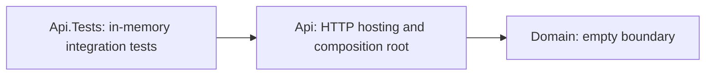

# Enterprise Case Intelligence

[](https://github.com/shivamchopra/enterprise-case-intelligence/actions/workflows/ci.yml)

**Foundation / Phase 0**

A small .NET 10 reference implementation for exploring enterprise case modernization. The current repository establishes a runnable, tested application boundary; business workflows and infrastructure are planned.

## Problem / Context

Case-centric enterprise processes often span legacy systems, fragmented information and manual handoffs. Modernization requires secure integration and operational reliability before AI-assisted workflows can be considered. This project explores that generic problem using synthetic concepts, without modeling any employer or client system.

## Project Goals

- Explore enterprise modernization patterns and disciplined software architecture.
- Document decisions, constraints and tradeoffs as requirements emerge.
- Evolve toward secure cloud deployment and asynchronous integration.
- Explore trustworthy AI integration in a later phase.

## Current Implemented Scope

- .NET 10 / ASP.NET Core Minimal API foundation.
- An intentionally empty Domain project establishing a dependency boundary.
- `GET /`: HTTP 200 with `service` and `status` metadata only.
- `GET /health`: ASP.NET Core health checks, with no external dependencies.
- In-memory integration tests for both endpoints.
- GitHub Actions restore, format verification, Release build and tests.
- Architecture overview and two accepted architecture decisions.

## Planned Evolution

**Planned / Conceptual:** relational persistence; Azure deployment; asynchronous/event-driven integration; Infrastructure as Code; structured observability; identity and authorization; Python-based AI capabilities; retrieval and AI evaluation; human approval boundaries. None is implemented today. Specific technologies and services will be chosen through future requirements and ADRs.

## Architecture at a Glance

Current architecture: one runnable API, one internal project boundary and an in-memory test host.



## Repository Structure

```text
src/EnterpriseCaseIntelligence.Api/       HTTP hosting and endpoints
src/EnterpriseCaseIntelligence.Domain/    Domain boundary; no models yet
tests/EnterpriseCaseIntelligence.Api.Tests/ Integration tests
docs/architecture/                       Current design and conceptual direction
docs/adr/                                Decision records
.github/                                 CI and dependency-update configuration
```

## Getting Started

Prerequisite: a stable **.NET 10 SDK** satisfying `global.json` (10.0.300 or a later stable feature band in the .NET 10.0 family). No cloud account, database, secret or environment variable is required.

```sh
git clone https://github.com/shivamchopra/enterprise-case-intelligence.git
cd enterprise-case-intelligence
dotnet restore EnterpriseCaseIntelligence.slnx
dotnet build EnterpriseCaseIntelligence.slnx --configuration Release --no-restore
dotnet run --project src/EnterpriseCaseIntelligence.Api --configuration Release --no-build -- --urls http://localhost:5080
```

In another terminal:

```sh
curl http://localhost:5080/
curl http://localhost:5080/health
```

The root returns `{"service":"Enterprise Case Intelligence","status":"foundation"}`. The health endpoint returns HTTP 200 when the application is healthy. With no dependency checks registered, it confirms the running host can respond; it does not establish readiness of future infrastructure.

## Build and Test

From the repository root, run the same quality gates as CI:

```sh
dotnet restore EnterpriseCaseIntelligence.slnx
dotnet format EnterpriseCaseIntelligence.slnx --verify-no-changes --no-restore
dotnet build EnterpriseCaseIntelligence.slnx --configuration Release --no-restore
dotnet test EnterpriseCaseIntelligence.slnx --configuration Release --no-build
```

Tests use `WebApplicationFactory<Program>` and do not call external services.

## Architecture Decisions

- [Architecture overview](docs/architecture/overview.md)
- [ADR index and process](docs/adr/README.md)
- [ADR 0001: Use .NET 10 and ASP.NET Core](docs/adr/0001-use-dotnet-10.md)
- [ADR 0002: Start with a modular application boundary](docs/adr/0002-start-with-a-modular-application-boundary.md)

## Security and Privacy

Synthetic/example concepts only. Never submit real customer, employer or client information, proprietary material or credentials. This foundation has no authentication or authorization and is not a production deployment. See [security reporting](SECURITY.md) and [contribution guidance](CONTRIBUTING.md).

## Roadmap

- **Now:** runnable foundation, integration tests, CI and documented boundaries.
- **Next:** define a small synthetic case use case and its requirements before adding domain behavior or persistence.
- **Later:** evaluate cloud hosting, asynchronous integration, identity, observability and trustworthy AI capabilities when justified.

## License

[MIT](LICENSE), copyright 2026 Shivam Chopra.
