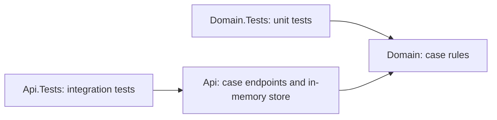

# Enterprise Case Intelligence

[](https://github.com/shivamchopra/enterprise-case-intelligence/actions/workflows/ci.yml)

**Phase 1: local synthetic case workflow**

A .NET 10 / ASP.NET Core reference project for enterprise case modernization. Today: create, retrieve and progress synthetic cases through a tested HTTP API backed by temporary host-owned memory. Domain rules, unit/integration tests, CI and architecture decisions support this local workflow.

[Review the implementation](#current-implemented-scope) · [Read the architecture](docs/architecture/overview.md) · [Run locally](#getting-started)

## Problem / Context

Enterprise case processes span legacy systems, fragmented information and manual handoffs. Modernization requires secure integration and operational reliability before future AI-assisted workflows. This project explores those concerns using synthetic concepts, without modeling any employer or client system.

## Project Goals

- Demonstrate .NET engineering through runnable code, tests and documented tradeoffs.
- Add architecture when requirements justify it.
- Evolve toward secure cloud deployment, asynchronous integration and trustworthy AI in later phases.

## Current Implemented Scope

| Implemented now | Evidence |
| --- | --- |
| `GET /`: service/foundation metadata. `GET /health`: framework health checks | [Program.cs](src/EnterpriseCaseIntelligence.Api/Program.cs) |
| Case creation, text validation and `New → InReview → Closed` lifecycle; Domain has no HTTP/storage dependencies | [Case model](src/EnterpriseCaseIntelligence.Domain/Cases/Case.cs) · [Statuses](src/EnterpriseCaseIntelligence.Domain/Cases/CaseStatus.cs) |
| Domain unit tests cover normalization, length boundaries, all status transitions and case isolation | [Domain tests](tests/EnterpriseCaseIntelligence.Domain.Tests) |
| `POST /cases`, `GET /cases/{id}`, `PUT /cases/{id}/status`: strict JSON validation and problem responses | [Case endpoints](src/EnterpriseCaseIntelligence.Api/Cases/CaseEndpoints.cs) |
| Host-owned in-memory store, synchronized operations and immutable snapshots | [Store](src/EnterpriseCaseIntelligence.Api/Cases/InMemoryCaseStore.cs) |
| In-memory integration tests cover the complete case workflow, foundation endpoints, host isolation and concurrent requests | [API tests](tests/EnterpriseCaseIntelligence.Api.Tests) |
| Restore, format verification, Release build and tests in CI; warnings treated as errors | [CI workflow](.github/workflows/ci.yml) · [Build configuration](Directory.Build.props) |
| Architecture overview and three accepted decisions | [Architecture overview](docs/architecture/overview.md) · [ADR index](docs/adr/README.md) |

**Local demonstration limits:** all case data is lost on host restart and never shared between instances. There is no authentication/authorization, durable persistence or enforced memory cap. Use synthetic data only.

Health checks confirm the host can respond, with no external dependencies checked. Tests require no database, cloud account, secrets or network services.

## Architecture at a Glance

One runnable API with a separate domain model; unit and integration tests exercise each boundary.



## Repository Structure

```text
src/
  EnterpriseCaseIntelligence.Api/        HTTP hosting, case endpoints and local store
  EnterpriseCaseIntelligence.Domain/     Case model and lifecycle rules
tests/
  EnterpriseCaseIntelligence.Api.Tests/  Endpoint integration tests
  EnterpriseCaseIntelligence.Domain.Tests/ Domain unit tests
docs/
  architecture/                         Design and conceptual direction
  adr/                                  Architecture decisions
  requirements/                         Workflow contract and acceptance coverage
  usage/                                Local workflow walkthrough
.github/                                CI and dependency updates
```

## Getting Started

Prerequisite: a stable **.NET 10 SDK** satisfying [global.json](global.json): 10.0.300 or a later stable patch/feature band within .NET 10.0. No environment variables or external infrastructure required.

```sh
git clone https://github.com/shivamchopra/enterprise-case-intelligence.git
cd enterprise-case-intelligence
dotnet restore EnterpriseCaseIntelligence.slnx
dotnet build EnterpriseCaseIntelligence.slnx --configuration Release --no-restore
dotnet run --project src/EnterpriseCaseIntelligence.Api --configuration Release --no-build -- --urls http://localhost:5080
```

In another terminal:

```sh
curl http://localhost:5080/
curl http://localhost:5080/health
```

Both return HTTP 200. The root returns `{"service":"Enterprise Case Intelligence","status":"foundation"}`; health returns `Healthy`.

Follow the [local case workflow walkthrough](docs/usage/local-case-workflow.md) to create a case, retrieve it and progress its status using curl.

## Build and Test

Run the same quality gates as CI from the repository root:

```sh
dotnet restore EnterpriseCaseIntelligence.slnx
dotnet format EnterpriseCaseIntelligence.slnx --verify-no-changes --no-restore
dotnet build EnterpriseCaseIntelligence.slnx --configuration Release --no-restore
dotnet test EnterpriseCaseIntelligence.slnx --configuration Release --no-build
```

## Architecture Decisions

- [Architecture overview](docs/architecture/overview.md): boundaries, constraints and conceptual future direction.
- [ADR index](docs/adr/README.md): decision process and status.
- [ADR 0001](docs/adr/0001-use-dotnet-10.md): use .NET 10 and ASP.NET Core.
- [ADR 0002](docs/adr/0002-start-with-a-modular-application-boundary.md): start with one small application and internal boundaries; justify independent services through requirements.
- [ADR 0003](docs/adr/0003-use-process-memory-for-the-phase-1-local-workflow.md): accepted process-memory storage for the implemented local Phase 1 workflow.
- [ADR 0004](docs/adr/0004-use-sqlite-for-the-durable-local-workflow.md): proposed SQLite storage for Phase 2; not implemented.

## Planned Evolution

**Planned / Conceptual — none is implemented today:** relational persistence; Azure deployment; asynchronous/event-driven integration; Infrastructure as Code; structured observability; identity and authorization; Python-based AI capabilities; retrieval; AI evaluation; human approval boundaries. Specific technologies and services require future requirements and ADRs.

## Roadmap

- **Now:** the local case workflow and its [reviewed acceptance criteria](docs/requirements/phase-1-case-workflow.md), plus foundation endpoints and tests.
- **Next:** review the [proposed SQLite decision](docs/adr/0004-use-sqlite-for-the-durable-local-workflow.md) against the [reviewed restart/durability requirements](docs/requirements/phase-2-durable-case-workflow.md), then implement the accepted decision. Phase 2 persistence is not implemented.
- **Later:** evaluate the planned capabilities against concrete needs and operational tradeoffs.

## Security and Privacy

Synthetic/example concepts only. Never submit real customer, employer or client information, proprietary material or credentials. This local workflow has no authentication or authorization and is not a production deployment. See [security reporting](SECURITY.md) and [contribution guidance](CONTRIBUTING.md).

## License

[MIT](LICENSE), copyright 2026 Shivam Chopra.
