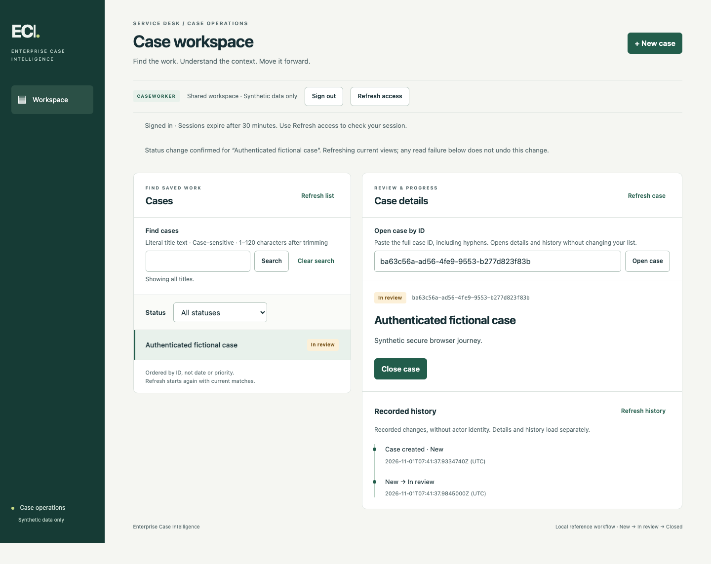
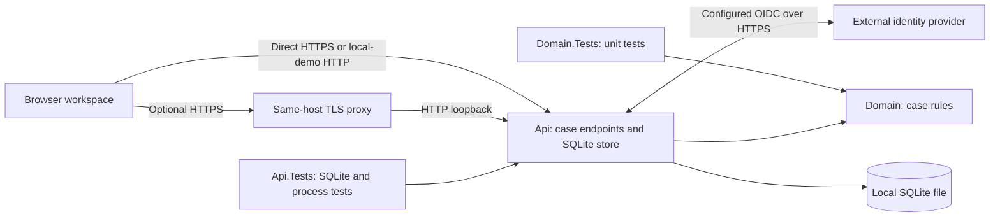

# Enterprise Case Intelligence

[](https://github.com/shivamchopra/enterprise-case-intelligence/actions/workflows/ci.yml)

**Phase 8 identity and ingress slices: authenticated case workspace**

A .NET 10 / ASP.NET Core reference project for enterprise case modernization. Today: find synthetic cases by literal title text and status, create one, review its details/history and progress its status in a local browser workspace or through the HTTP API. EF Core Code First and a retained SQLite file provide durable state and retry-safe creation. Configured OIDC sign-in, Reader/Caseworker policies, protected sessions and CSRF now support an authenticated browser/API slice. An optional same-host HTTPS proxy path is also tested. Private local Microsoft Entra role and session-revocation checks have passed; hosted operations acceptance remains pending. Domain, API, browser and recovery tests support the implemented workflows.

[Review the implementation](#current-implemented-scope) · [Read the architecture](docs/architecture/overview.md) · [Run locally](#getting-started)



Shown with a disposable test identity over HTTPS. No real tenant or hosted deployment is demonstrated.

## Problem / Context

Enterprise case processes span legacy systems, fragmented information and manual handoffs. Modernization requires secure integration and operational reliability before future AI-assisted workflows. This project explores those concerns using synthetic concepts, without modeling any employer or client system.

## Project Goals

- Demonstrate .NET engineering through runnable code, tests and documented tradeoffs.
- Add architecture when requirements justify it.
- Use EF Core Code First models, LINQ and migrations for persistence.
- Evolve toward secure cloud deployment, asynchronous integration and trustworthy AI in later phases.

## Current Implemented Scope

| Implemented now | Evidence |
| --- | --- |
| `GET /`: service/foundation metadata. `GET /health`: framework health checks | [Program.cs](src/EnterpriseCaseIntelligence.Api/Program.cs) |
| `/workspace`: same-host browser journey with bounded pages, status filtering, details/history, safe creation retries and status progression | [Workspace assets and routes](src/EnterpriseCaseIntelligence.Api/Workspace) · [Real-browser tests](tests/EnterpriseCaseIntelligence.Api.Tests/Workspace/WorkspaceBrowserTests.cs) |
| Explicit loopback LocalDemo or HTTPS OIDC mode; Reader/Caseworker policies, 30-minute encrypted sessions, CSRF and session-loss handling | [Security implementation](src/EnterpriseCaseIntelligence.Api/Security) · [API/browser security tests](tests/EnterpriseCaseIntelligence.Api.Tests/Security) · [Configuration/runbook](docs/usage/authenticated-case-workspace.md) |
| File or private-configuration protection certificate, encrypted retained session keys and refusal of incompatible replacement before key generation | [Certificate loader](src/EnterpriseCaseIntelligence.Api/Security/ProtectionCertificate.cs) · [Security tests](tests/EnterpriseCaseIntelligence.Api.Tests/Security/ProtectionCertificateTests.cs) · [Source-switch runbook](docs/usage/authenticated-case-workspace.md#protection-certificate-sources) |
| Optional single-hop HTTPS proxy ingress to an explicit HTTP loopback backend, with physical-peer/protocol/host checks | [Ingress implementation](src/EnterpriseCaseIntelligence.Api/Security/CaseIngress.cs) · [API/process tests](tests/EnterpriseCaseIntelligence.Api.Tests/Security/CaseIngressTests.cs) · [Proxy contract](docs/usage/proxy-case-workspace.md) |
| Case creation, text validation and `New → InReview → Closed` lifecycle; Domain has no HTTP/storage dependencies | [Case model](src/EnterpriseCaseIntelligence.Domain/Cases/Case.cs) · [Statuses](src/EnterpriseCaseIntelligence.Domain/Cases/CaseStatus.cs) |
| Domain unit tests cover normalization, length boundaries, all status transitions and case isolation | [Domain tests](tests/EnterpriseCaseIntelligence.Domain.Tests) |
| `POST /cases`, `GET /cases/{id}`, `PUT /cases/{id}/status`: strict JSON validation and problem responses | [Case endpoints](src/EnterpriseCaseIntelligence.Api/Cases/CaseEndpoints.cs) |
| `GET /cases`: literal case-sensitive title search, optional status filtering, bounded pages and canonical-ID continuation | [Title search tests](tests/EnterpriseCaseIntelligence.Api.Tests/Cases/CaseTitleSearchTests.cs) · [List acceptance tests](tests/EnterpriseCaseIntelligence.Api.Tests/Cases/CaseListPaginationTests.cs) |
| `GET /cases/{id}/history`: bounded status history; creation and actual transitions commit with their entries; same-status retries add nothing | [History API tests](tests/EnterpriseCaseIntelligence.Api.Tests/Cases/CaseHistoryApiTests.cs) · [Paired-write failure tests](tests/EnterpriseCaseIntelligence.Api.Tests/Cases/CaseHistoryFailureTests.cs) |
| Optional quoted `Idempotency-Key` on creation: atomic binding, original-result replay and safe `422` on changed fields | [Retry API tests](tests/EnterpriseCaseIntelligence.Api.Tests/Cases/CaseKeyApiTests.cs) · [Atomic failure tests](tests/EnterpriseCaseIntelligence.Api.Tests/Cases/CaseKeyFailureTests.cs) |
| EF Core LINQ/tracked writes, explicit SQLite transactions, commit-before-success and immutable snapshots | [Store](src/EnterpriseCaseIntelligence.Api/Cases/SqliteCaseStore.cs) |
| C# model, Fluent API and scaffolded EF migrations/snapshot own new schema; initialization and startup validate format 4 | [EF context](src/EnterpriseCaseIntelligence.Api/Cases/CaseDbContext.cs) · [Migrations](src/EnterpriseCaseIntelligence.Api/Cases/Migrations) |
| Explicit initialization, schema validation and safe startup refusal | [Database lifecycle](src/EnterpriseCaseIntelligence.Api/Cases/CaseDatabase.cs) |
| Explicit offline version-1/version-2/version-3 → version-4 upgrades, preserved histories and inspection after uncertain outcomes | [EF adoption tests](tests/EnterpriseCaseIntelligence.Api.Tests/Cases/CaseEfAdoptionTests.cs) · [Upgrade interruption tests](tests/EnterpriseCaseIntelligence.Api.Tests/Cases/CaseUpgradeProcessTests.cs) |
| Real SQLite integration tests and child-process tests cover the workflow, failures, host isolation and restart recovery | [API tests](tests/EnterpriseCaseIntelligence.Api.Tests) |
| Optional .NET 10 operator tool checks runtime/F1 catalogs and an undeployed probe resource envelope; deployment readiness remains false | [Checker](tools/ReviewHostPreflight.cs) · [Probe proposal](infra/review-probe/README.md) · [Verification contract](docs/tasks/managed-ingress-verification.md) |
| Independent operator probe with private bearer access, raw transport observations and encrypted-key receipt checks across local restart/replacement | [Probe runbook](docs/usage/operator-review-probe.md) · [Process/client tests](tests/EnterpriseCaseIntelligence.Api.Tests/Hosting/ReviewProbeTests.cs) |
| Explicit authenticated preparation phase, unchanged storage guards and read-only retained-key proof before normal serving | [Preparation sequence](docs/usage/operator-review-probe.md#explicit-preparation-and-initialization) · [Lifecycle tests](tests/EnterpriseCaseIntelligence.Api.Tests/Hosting/ReviewProbePreparationTests.cs) |
| Restore, format verification, Release build and tests in CI; warnings treated as errors | [CI workflow](.github/workflows/ci.yml) · [Build configuration](Directory.Build.props) |
| Architecture overview and accepted decisions; historical memory decision retained | [Architecture overview](docs/architecture/overview.md) · [ADR index](docs/adr/README.md) |

**Local demonstration limits:** one API process uses one local store at a time. Committed data survives API restart with the same intact file; power/storage loss, backup, multi-instance operation, hosted release and enforced disk quotas remain outside scope. Explicit LocalDemo mode has no user permission boundary; Oidc requires private configuration and a valid public HTTPS origin, served directly or through the explicit same-host proxy contract. Use synthetic data only.

Creation keys remain bound for the store’s lifetime, without expiry or release. Retry with the same key and equivalent normalized fields; a new or omitted key can create another case. Replay returns the original `New` result; retrieve its `Location` for current state.

Health checks confirm host liveness, without checking storage readiness. Tests use disposable SQLite files and loopback HTTP child processes, plus test-only HTTPS/OIDC fixtures; no external database server, cloud account or real identity secret is required for tests or LocalDemo.

History describes recorded state changes, without actor identity or tamper evidence. Older cases receive a baseline at explicit upgrade; their earlier transitions and creation times remain unknown.

## Architecture at a Glance

One runnable ASP.NET host serves the API and browser assets, with a separate domain model; unit, integration and browser tests exercise the workflow.



## Repository Structure

```text
src/
  EnterpriseCaseIntelligence.Api/        HTTP hosting, workspace assets, case endpoints and SQLite lifecycle
  EnterpriseCaseIntelligence.Domain/     Case model and lifecycle rules
tests/
  EnterpriseCaseIntelligence.Api.Tests/  Endpoint, SQLite and process recovery tests
  EnterpriseCaseIntelligence.Domain.Tests/ Domain unit tests
  EnterpriseCaseIntelligence.UpgradeFixture/ Test-only upgrade interruption executable
tools/
  EnterpriseCaseIntelligence.ReviewProbe/ Independent diagnostic host/client, no case API
  ReviewHostPreflight.cs                 Catalog and offline resource-envelope checks
docs/
  architecture/                         Design and conceptual direction
  adr/                                  Architecture decisions
  requirements/                         Workflow contract and acceptance coverage
  usage/                                Local workflow walkthrough
.github/                                CI and dependency updates
```

## Getting Started

Prerequisite: a stable **.NET 10 SDK** satisfying [global.json](global.json): 10.0.300 or a later stable patch/feature band within .NET 10.0. The SQLite native engine comes through NuGet. Commands below use a POSIX shell; choose an absolute path on an ordinary local filesystem, outside network shares or synchronization-managed folders.

```sh
git clone https://github.com/shivamchopra/enterprise-case-intelligence.git
cd enterprise-case-intelligence
dotnet restore EnterpriseCaseIntelligence.slnx
dotnet build EnterpriseCaseIntelligence.slnx --configuration Release --no-restore
mkdir -p "$HOME/.local/share/enterprise-case-intelligence"
CASE_DB_PATH="$HOME/.local/share/enterprise-case-intelligence/cases.db"
# Initialize once for a NEW file. Skip this command when reusing an existing store.
dotnet run --project src/EnterpriseCaseIntelligence.Api --configuration Release --no-build -- init-store --CaseStorage:DatabasePath "$CASE_DB_PATH"
dotnet run --project src/EnterpriseCaseIntelligence.Api --configuration Release --no-build -- --CaseStorage:DatabasePath "$CASE_DB_PATH" --Security:Mode LocalDemo --urls http://localhost:5080
```

Normal startup also requires an explicit security mode. The commands above select the loopback-only demo; see the [authenticated configuration and revocation runbook](docs/usage/authenticated-case-workspace.md) for Oidc. Missing mode fails closed. Normal startup requires the configured existing file; it does not create or repair one. Initialization refuses any existing file. To resume later, rerun only the final command against the same path. `CaseStorage__DatabasePath` is the equivalent environment setting.

Fresh initialization creates schema version 4 through EF migrations. A retained version-1, version-2 or version-3 store requires a deliberate offline upgrade; see [inspection, upgrade and recovery commands](docs/usage/local-case-workflow.md#inspect-and-upgrade-an-older-store). The upgrade is one-way: older executables cannot open version 4. Normal startup never upgrades automatically.

In another terminal:

```sh
curl http://localhost:5080/
curl http://localhost:5080/health
```

Both return HTTP 200. The root returns `{"service":"Enterprise Case Intelligence","status":"foundation"}`; health returns `Healthy`.

Open [the local workspace](http://localhost:5080/workspace) in a modern browser. Create a fictional case, select it, choose **Start review**, inspect recorded history and choose **Close case**. The workspace uses the same initialized store and API, with no frontend server, Node runtime or external assets. See the [browser walkthrough and recovery limits](docs/usage/local-case-workflow.md#browser-workspace).

To find saved work, enter part of its title under **Find cases** and choose **Search** (or Enter). Matching is literal and case-sensitive; `guide` matches `Sample guide` but not `Sample Guide`. Combine it with Status, follow Next page, or Clear search. Editing alone does not change the submitted search. See the [API search example](docs/usage/local-case-workflow.md#find-cases-by-title).

Follow the [local case workflow walkthrough](docs/usage/local-case-workflow.md) to create a case, browse saved work, retrieve it, progress its status and inspect its history using curl. The [retry example](docs/usage/local-case-workflow.md#retry-a-creation-with-a-retained-key) shows how to reconcile a lost creation response.

## Build and Test

Run the same quality gates as CI from the repository root:

```sh
dotnet restore EnterpriseCaseIntelligence.slnx
dotnet tool restore
dotnet format EnterpriseCaseIntelligence.slnx --verify-no-changes --no-restore
dotnet build EnterpriseCaseIntelligence.slnx --configuration Release --no-restore
dotnet ef migrations has-pending-model-changes --project src/EnterpriseCaseIntelligence.Api --configuration Release --no-build
# Install once per Playwright update; on Linux use install --with-deps chromium if needed.
dotnet exec --runtimeconfig tests/EnterpriseCaseIntelligence.Api.Tests/bin/Release/net10.0/EnterpriseCaseIntelligence.Api.Tests.runtimeconfig.json tests/EnterpriseCaseIntelligence.Api.Tests/bin/Release/net10.0/Microsoft.Playwright.dll install chromium
dotnet test EnterpriseCaseIntelligence.slnx --configuration Release --no-build
```

The full suite includes Chromium tests. A backend-only run can use `--filter 'Category!=Browser'`; CI also runs a separate browser job: existing LocalDemo journeys use the published executable, and authenticated journeys use a test-hosted HTTPS app with a disposable OIDC provider. The browser download is test tooling, not an application runtime requirement.

## Architecture Decisions

- [Architecture overview](docs/architecture/overview.md): boundaries, constraints and conceptual future direction.
- [ADR index](docs/adr/README.md): decision process and status.
- [ADR 0001](docs/adr/0001-use-dotnet-10.md): use .NET 10 and ASP.NET Core.
- [ADR 0002](docs/adr/0002-start-with-a-modular-application-boundary.md): start with one small application and internal boundaries; justify independent services through requirements.
- [ADR 0003](docs/adr/0003-use-process-memory-for-the-phase-1-local-workflow.md): historical Phase 1 process-memory decision, superseded by ADR 0004.
- [ADR 0004](docs/adr/0004-use-sqlite-for-the-durable-local-workflow.md): accepted and implemented SQLite storage for the durable local Phase 2 workflow.
- [ADR 0005](docs/adr/0005-add-status-history-with-an-explicit-store-upgrade.md): accepted and implemented amendment for atomic status history and an explicit store upgrade.
- [ADR 0006](docs/adr/0006-bind-creation-keys-in-the-local-case-store.md): accepted and implemented creation-key bindings, original-result replay and direct upgrades to version 3.
- [ADR 0007](docs/adr/0007-adopt-ef-core-code-first.md): implemented EF Core Code First models, generated migrations and validated adoption of retained stores.
- [ADR 0008](docs/adr/0008-serve-a-local-browser-case-workspace.md): same-host embedded browser assets, explicit client state and real Chromium verification.

- [ADR 0009](docs/adr/0009-authenticate-the-shared-case-workspace.md): framework OIDC/cookie sessions, named policies, CSRF and explicit local exception.
- [ADR 0010](docs/adr/0010-trust-a-single-loopback-https-proxy.md): explicit single-hop loopback ingress without broad forwarding trust.
- [ADR 0011](docs/adr/0011-use-entra-for-private-review-identity.md): Entra selection and private local role/revocation evidence, with credentials outside Git.
- [ADR 0012](docs/adr/0012-gate-cloud-hosting-on-zero-recurring-cost.md): zero recurring hosting cost; continue locally while free-tier compatibility is assessed.
- [ADR 0013](docs/adr/0013-load-protection-certificates-from-private-configuration.md): opt-in private-configuration certificates and retained-key compatibility validation.
- [ADR 0014](docs/adr/0014-isolate-managed-host-verification-in-an-operator-probe.md): separate locally tested operator probe; cloud acceptance pending.
- [ADR 0015](docs/adr/0015-prepare-probe-storage-before-explicit-initialization.md): explicit preparation and read-only initialization evidence; existing storage and startup guards retained.

## Planned Evolution

**Planned / Conceptual — none is implemented today:** server-managed persistence such as SQL Server / Azure SQL; Azure deployment; asynchronous/event-driven integration; operational infrastructure/release automation; restricted structured observability; remaining real-provider/hosted acceptance; Python-based AI capabilities; retrieval; AI evaluation; human approval boundaries. Specific technologies and services require future requirements and ADRs.

## Roadmap

- **Now:** [authenticated Reader/Caseworker access](docs/usage/authenticated-case-workspace.md) and [same-host proxy support](docs/usage/proxy-case-workspace.md), plus [case title search](docs/requirements/phase-7-case-title-search.md#current-implementation-coverage) in the browser/API journey, alongside retry-safe creation, status history and process-recovery coverage.
- **Completed:** [EF Core Code First adoption](docs/tasks/ef-core-code-first-adoption.md) with retained-data and migration-recovery coverage.
- **Verified privately:** [real Entra Reader, Caseworker, unmapped-role and emergency session-revocation flows](docs/usage/entra-review-verification.md#local-verification-on-2026-10-26), using one approved account and a local synthetic store. Account details and credentials stay outside Git.
- **Next — not implemented:** complete [secure review hosting](docs/requirements/phase-8-secure-hosting.md), including compatible storage/ingress, operational recovery and hosted provider/multi-user checks. The [$0 cost boundary](docs/tasks/zero-cost-review-hosting.md) keeps development local while App Service F1 + Azure SQL free limits are assessed; that stack is not supported yet. The [independent operator probe](docs/usage/operator-review-probe.md) has local preparation, access and retained-key receipt evidence. Its [preparation-only deployment proposal](docs/tasks/preparation-only-deployment-proposal.md) now fixes initial startup and defines resource/configuration/release/removal boundaries. Fresh private reads still do not establish eligible allocation; resolve eligibility/policy evidence before creation review. Actual platform storage/isolation must pass before key initialization; cloud ingress and key retention remain unverified. No cloud compute or public deployment is provisioned. The earlier VM option requires separately approved costs; local Entra evidence does not establish hosted acceptance.
- **Deferred:** [storage readiness](docs/requirements/phase-6-storage-readiness.md), to revisit against the selected hosting/provider design. `/health` remains storage-independent liveness.
- **Later:** extend the business workflow, establish secure hosting, then evaluate integration and AI against concrete scenarios. The [project roadmap](docs/roadmap.md) explains priorities and prerequisites; these capabilities are not implemented.

## Security and Privacy

Synthetic/example concepts only. Never submit real customer, employer or client information, proprietary material or credentials. LocalDemo deliberately has no sign-in; configured Oidc enforces authenticated permissions and CSRF. Neither mode establishes a production deployment. See [security reporting](SECURITY.md) and [contribution guidance](CONTRIBUTING.md).

## License

[MIT](LICENSE), copyright 2026 Shivam Chopra.
