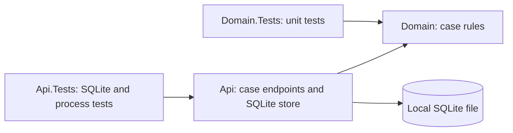

# Enterprise Case Intelligence

[](https://github.com/shivamchopra/enterprise-case-intelligence/actions/workflows/ci.yml)

**Phase 2: durable local synthetic case workflow**

A .NET 10 / ASP.NET Core reference project for enterprise case modernization. Today: create, retrieve and progress synthetic cases through a tested HTTP API backed by a retained local SQLite file. Domain rules, unit/integration tests, CI and architecture decisions support this local workflow.

[Review the implementation](#current-implemented-scope) · [Read the architecture](docs/architecture/overview.md) · [Run locally](#getting-started)

## Problem / Context

Enterprise case processes span legacy systems, fragmented information and manual handoffs. Modernization requires secure integration and operational reliability before future AI-assisted workflows. This project explores those concerns using synthetic concepts, without modeling any employer or client system.

## Project Goals

- Demonstrate .NET engineering through runnable code, tests and documented tradeoffs.
- Add architecture when requirements justify it.
- Evolve toward secure cloud deployment, asynchronous integration and trustworthy AI in later phases.

## Current Implemented Scope

| Implemented now | Evidence |
| --- | --- |
| `GET /`: service/foundation metadata. `GET /health`: framework health checks | [Program.cs](src/EnterpriseCaseIntelligence.Api/Program.cs) |
| Case creation, text validation and `New → InReview → Closed` lifecycle; Domain has no HTTP/storage dependencies | [Case model](src/EnterpriseCaseIntelligence.Domain/Cases/Case.cs) · [Statuses](src/EnterpriseCaseIntelligence.Domain/Cases/CaseStatus.cs) |
| Domain unit tests cover normalization, length boundaries, all status transitions and case isolation | [Domain tests](tests/EnterpriseCaseIntelligence.Domain.Tests) |
| `POST /cases`, `GET /cases/{id}`, `PUT /cases/{id}/status`: strict JSON validation and problem responses | [Case endpoints](src/EnterpriseCaseIntelligence.Api/Cases/CaseEndpoints.cs) |
| SQLite transactions, synchronized operations, commit-before-success and immutable snapshots | [Store](src/EnterpriseCaseIntelligence.Api/Cases/SqliteCaseStore.cs) |
| Explicit initialization, schema validation and safe startup refusal | [Database lifecycle](src/EnterpriseCaseIntelligence.Api/Cases/CaseDatabase.cs) |
| Real SQLite integration tests and child-process tests cover the workflow, failures, host isolation and restart recovery | [API tests](tests/EnterpriseCaseIntelligence.Api.Tests) |
| Restore, format verification, Release build and tests in CI; warnings treated as errors | [CI workflow](.github/workflows/ci.yml) · [Build configuration](Directory.Build.props) |
| Architecture overview and three current accepted decisions; historical memory decision retained | [Architecture overview](docs/architecture/overview.md) · [ADR index](docs/adr/README.md) |

**Local demonstration limits:** one API process uses one local store at a time. Committed data survives API restart with the same intact file; power/storage loss, backup, multi-instance operation, authentication/authorization and enforced disk quotas are outside scope. Use synthetic data only.

Health checks confirm host liveness, without checking storage readiness. Tests use disposable SQLite files and loopback HTTP child processes; no separately installed database server, cloud account or secret is required.

## Architecture at a Glance

One runnable API with a separate domain model; unit and integration tests exercise each boundary.



## Repository Structure

```text
src/
  EnterpriseCaseIntelligence.Api/        HTTP hosting, case endpoints and SQLite lifecycle
  EnterpriseCaseIntelligence.Domain/     Case model and lifecycle rules
tests/
  EnterpriseCaseIntelligence.Api.Tests/  Endpoint, SQLite and process recovery tests
  EnterpriseCaseIntelligence.Domain.Tests/ Domain unit tests
docs/
  architecture/                         Design and conceptual direction
  adr/                                  Architecture decisions
  requirements/                         Workflow contract and acceptance coverage
  usage/                                Local workflow walkthrough
.github/                                CI and dependency updates
```

## Getting Started

Prerequisite: a stable **.NET 10 SDK** satisfying [global.json](global.json): 10.0.300 or a later stable patch/feature band within .NET 10.0. The SQLite native engine comes through NuGet. Commands below use a POSIX shell; choose an absolute path on an ordinary local filesystem, outside network shares or synchronization-managed folders.

```sh
git clone https://github.com/shivamchopra/enterprise-case-intelligence.git
cd enterprise-case-intelligence
dotnet restore EnterpriseCaseIntelligence.slnx
dotnet build EnterpriseCaseIntelligence.slnx --configuration Release --no-restore
mkdir -p "$HOME/.local/share/enterprise-case-intelligence"
CASE_DB_PATH="$HOME/.local/share/enterprise-case-intelligence/cases.db"
# Initialize once for a NEW file. Skip this command when reusing an existing store.
dotnet run --project src/EnterpriseCaseIntelligence.Api --configuration Release --no-build -- init-store --CaseStorage:DatabasePath "$CASE_DB_PATH"
dotnet run --project src/EnterpriseCaseIntelligence.Api --configuration Release --no-build -- --CaseStorage:DatabasePath "$CASE_DB_PATH" --urls http://localhost:5080
```

Normal startup requires the configured existing file; it does not create or repair one. Initialization refuses any existing file. To resume later, rerun only the final command against the same path. `CaseStorage__DatabasePath` is the equivalent environment setting.

In another terminal:

```sh
curl http://localhost:5080/
curl http://localhost:5080/health
```

Both return HTTP 200. The root returns `{"service":"Enterprise Case Intelligence","status":"foundation"}`; health returns `Healthy`.

Follow the [local case workflow walkthrough](docs/usage/local-case-workflow.md) to create a case, retrieve it and progress its status using curl.

## Build and Test

Run the same quality gates as CI from the repository root:

```sh
dotnet restore EnterpriseCaseIntelligence.slnx
dotnet format EnterpriseCaseIntelligence.slnx --verify-no-changes --no-restore
dotnet build EnterpriseCaseIntelligence.slnx --configuration Release --no-restore
dotnet test EnterpriseCaseIntelligence.slnx --configuration Release --no-build
```

## Architecture Decisions

- [Architecture overview](docs/architecture/overview.md): boundaries, constraints and conceptual future direction.
- [ADR index](docs/adr/README.md): decision process and status.
- [ADR 0001](docs/adr/0001-use-dotnet-10.md): use .NET 10 and ASP.NET Core.
- [ADR 0002](docs/adr/0002-start-with-a-modular-application-boundary.md): start with one small application and internal boundaries; justify independent services through requirements.
- [ADR 0003](docs/adr/0003-use-process-memory-for-the-phase-1-local-workflow.md): historical Phase 1 process-memory decision, superseded by ADR 0004.
- [ADR 0004](docs/adr/0004-use-sqlite-for-the-durable-local-workflow.md): accepted and implemented SQLite storage for the durable local Phase 2 workflow.

## Planned Evolution

**Planned / Conceptual — none is implemented today:** server-managed persistence such as SQL Server / Azure SQL; Azure deployment; asynchronous/event-driven integration; Infrastructure as Code; structured observability; identity and authorization; Python-based AI capabilities; retrieval; AI evaluation; human approval boundaries. Specific technologies and services require future requirements and ADRs.

## Roadmap

- **Now:** the case HTTP contract plus [durability acceptance coverage](docs/requirements/phase-2-durable-case-workflow.md), local initialization and recovery tests.
- **Next:** review the durable workflow and define the next concrete requirement before expanding storage, deployment or architecture.
- **Later:** evaluate the planned capabilities against concrete needs and operational tradeoffs.

## Security and Privacy

Synthetic/example concepts only. Never submit real customer, employer or client information, proprietary material or credentials. This local workflow has no authentication or authorization and is not a production deployment. See [security reporting](SECURITY.md) and [contribution guidance](CONTRIBUTING.md).

## License

[MIT](LICENSE), copyright 2026 Shivam Chopra.
