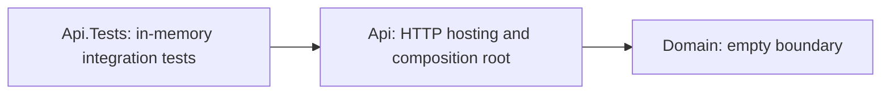

# Enterprise Case Intelligence

[](https://github.com/shivamchopra/enterprise-case-intelligence/actions/workflows/ci.yml)

**Foundation / Phase 0**

A .NET 10 / ASP.NET Core reference project for enterprise case modernization. Today: one small API, an explicit domain boundary, integration tests, CI and architecture decisions. Business workflows and infrastructure are planned.

[Review the implementation](#current-implemented-scope) · [Read the architecture](docs/architecture/overview.md) · [Run locally](#getting-started)

## Problem / Context

Enterprise case processes span legacy systems, fragmented information and manual handoffs. Modernization requires secure integration and operational reliability before future AI-assisted workflows. This project explores those concerns using synthetic concepts, without modeling any employer or client system.

## Project Goals

- Demonstrate .NET engineering through runnable code, tests and documented tradeoffs.
- Add architecture when requirements justify it.
- Evolve toward secure cloud deployment, asynchronous integration and trustworthy AI in later phases.

## Current Implemented Scope

| Implemented now | Evidence |
| --- | --- |
| `GET /`: service/foundation metadata. `GET /health`: framework health checks | [Program.cs](src/EnterpriseCaseIntelligence.Api/Program.cs) |
| Api → Domain dependency; Domain intentionally empty | [Api project reference](src/EnterpriseCaseIntelligence.Api/EnterpriseCaseIntelligence.Api.csproj) |
| Two in-memory integration tests using `WebApplicationFactory<Program>` | [Endpoint tests](tests/EnterpriseCaseIntelligence.Api.Tests) |
| Restore, format verification, Release build and tests in CI; warnings treated as errors | [CI workflow](.github/workflows/ci.yml) · [Build configuration](Directory.Build.props) |
| Architecture overview and two accepted decisions | [Architecture overview](docs/architecture/overview.md) · [ADR index](docs/adr/README.md) |

Health checks confirm the host can respond, with no external dependencies checked. Tests require no database, cloud account, secrets or network services.

## Architecture at a Glance

One runnable API, one internal boundary and an in-memory test host.



## Repository Structure

```text
src/
  EnterpriseCaseIntelligence.Api/        HTTP hosting and endpoints
  EnterpriseCaseIntelligence.Domain/     Domain boundary; no models yet
tests/
  EnterpriseCaseIntelligence.Api.Tests/  Integration tests
docs/
  architecture/                         Design and conceptual direction
  adr/                                  Architecture decisions
  requirements/                         Proposed behavior and acceptance criteria
.github/                                CI and dependency updates
```

## Getting Started

Prerequisite: a stable **.NET 10 SDK** satisfying [global.json](global.json): 10.0.300 or a later stable patch/feature band within .NET 10.0. No environment variables or external infrastructure required.

```sh
git clone https://github.com/shivamchopra/enterprise-case-intelligence.git
cd enterprise-case-intelligence
dotnet restore EnterpriseCaseIntelligence.slnx
dotnet build EnterpriseCaseIntelligence.slnx --configuration Release --no-restore
dotnet run --project src/EnterpriseCaseIntelligence.Api --configuration Release --no-build -- --urls http://localhost:5080
```

In another terminal:

```sh
curl http://localhost:5080/
curl http://localhost:5080/health
```

Both return HTTP 200. The root returns `{"service":"Enterprise Case Intelligence","status":"foundation"}`; health returns `Healthy`.

## Build and Test

Run the same quality gates as CI from the repository root:

```sh
dotnet restore EnterpriseCaseIntelligence.slnx
dotnet format EnterpriseCaseIntelligence.slnx --verify-no-changes --no-restore
dotnet build EnterpriseCaseIntelligence.slnx --configuration Release --no-restore
dotnet test EnterpriseCaseIntelligence.slnx --configuration Release --no-build
```

## Architecture Decisions

- [Architecture overview](docs/architecture/overview.md): boundaries, constraints and conceptual future direction.
- [ADR index](docs/adr/README.md): decision process and status.
- [ADR 0001](docs/adr/0001-use-dotnet-10.md): use .NET 10 and ASP.NET Core.
- [ADR 0002](docs/adr/0002-start-with-a-modular-application-boundary.md): start with one small application and internal boundaries; justify independent services through requirements.

## Planned Evolution

**Planned / Conceptual — none is implemented today:** relational persistence; Azure deployment; asynchronous/event-driven integration; Infrastructure as Code; structured observability; identity and authorization; Python-based AI capabilities; retrieval; AI evaluation; human approval boundaries. Specific technologies and services require future requirements and ADRs.

## Roadmap

- **Now:** the runnable, tested and documented Phase 0 foundation.
- **Next:** review the [proposed Phase 1 case workflow](docs/requirements/phase-1-case-workflow.md), then implement its agreed domain rules and tests. Case endpoints and storage remain unimplemented.
- **Later:** evaluate the planned capabilities against concrete needs and operational tradeoffs.

## Security and Privacy

Synthetic/example concepts only. Never submit real customer, employer or client information, proprietary material or credentials. This foundation has no authentication or authorization and is not a production deployment. See [security reporting](SECURITY.md) and [contribution guidance](CONTRIBUTING.md).

## License

[MIT](LICENSE), copyright 2026 Shivam Chopra.
