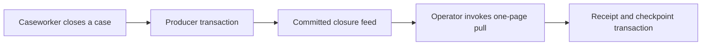

# 0017 Use a transactional closure feed

- Status: Accepted. Producer and receipt consumer implemented locally.
- Date: 2026-11-05

## Context

A synthetic records intake process needs to pick up cases that close while intake is stopped. Format 5 records closure in per-case history. The existing filtered case list orders by case ID, and a case that closes below a saved ID boundary is missed when the consumer continues from that boundary. The running API reproduced this with three disposable cases. [Phase 10 contract and baseline evidence](../requirements/phase-10-case-closure-handoff.md#evidence-from-the-existing-api)

## Decision

Append a closure notice in the existing case-status transaction. A small retained table carries the generated position and a unique reference to the case's closure history entry. A single persisted stream identity binds checkpoints to the initialized source. The read projects the timestamp from that history entry and the fixed versioned event type. Use the same writer transaction, scoped EF context and commit-before-success boundary as the status write.

Use an ordered, bounded HTTP pull through the existing loopback `LocalDemo` mode. The consumer runs as a separate one-page command with its own Code First receipt file. The singleton checkpoint binds the file to one stream, so each receipt position identifies an event within that stream. The consumer compares its expected checkpoint inside a SQLite writer transaction. It commits receipts and the new checkpoint together. A stale attempt may reconcile an already applied nonempty page when every retained receipt matches, leaving the current checkpoint in place.

The scaffolded format-6 migration adds two STRICT tables through the existing provider SQL generator. SQLite allocates positive positions with an AUTOINCREMENT key. A composite foreign key references the retained history entry, and a unique constraint allows one notice per entry. The offline upgrade preserves retained formats 1–5 and assigns a new stream identity with zero notices. Existing Closed history stays in the case file. A subsequent actual closure appends a notice through the same status path. Exact historical schema and metadata validation, rollback on interruption, and no-overwrite initialization remain gates. [EF adoption and format-5 precedent](0016-expose-case-priority-without-changing-creation-replay.md)

The intake command has explicit initialization and checkpoint inspection because a process can exit after commit and before printing success. Inspection reports receipt count and position. Process tests terminate intake at receipt and checkpoint writes and again after commit, then reconcile through the retained file. [Operator walkthrough](../usage/local-records-intake.md).

## Alternatives and consequences

Re-scanning the closed-case list from the beginning and deduplicating every pass can eventually find the missed case in the experiment. It repeatedly visits old cases and has no position that represents a committed closure. Timestamp polling also needs tie-breaking and a policy for clock regression. A durable generated position fits the one-writer local store and the demonstrated continuation gap.

Publishing to a broker from the status request introduces a second commit boundary and requires proof of recovery when either side fails. The pull design lets the local producer and consumer demonstrate those recovery semantics with existing .NET and SQLite tooling. Hosted delivery, broker selection, service credentials, retention and backup restoration can be assessed from that evidence under the existing hosting boundary. [Zero recurring hosting cost decision](0012-gate-cloud-hosting-on-zero-recurring-cost.md)
