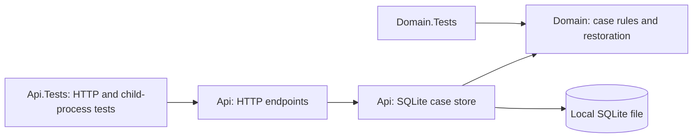
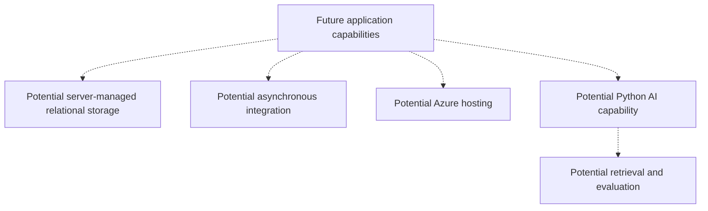

# Architecture overview

## Context and objectives

This reference project explores enterprise case modernization using generic synthetic concepts, without reproducing an employer or client system. Maintainability, evolvability, reliability, testability and explicit tradeoffs guide current choices. Production security, cloud readiness and structured observability require future work.

## Current architecture

One ASP.NET Core .NET 10 Minimal API is the only deployable application. It exposes `/`, `/health` and three case operations. The Api project also owns SQLite setup and access; Domain owns case rules and restoration. No separate persistence service or project exists.

## Boundaries and dependency direction

- **Api:** composition root, HTTP parsing/error mapping, SQLite configuration/initialization, schema checks and one concrete store per host. Provider failures remain generic `500 internal_error`; a rejected domain transition has an explicit store outcome mapped to `409 invalid_transition`.
- **Domain:** immutable ID/text, creation validation, `New → InReview → Closed` lifecycle and validated restoration of existing cases. It references no web, provider or infrastructure code. Restoration rejects damaged/unnormalized text, empty IDs and undefined statuses without defaulting or replaying transitions.
- **Tests:** Api.Tests references Api and exercises actual SQLite files, in-process HTTP hosts and real API child processes. Domain.Tests references Domain directly and needs no database.

Api references Domain. No generic repository, provider interface, ORM or additional production project is introduced. Stored mutable entities never escape for HTTP serialization; callers receive immutable four-field snapshots.

## Storage lifecycle and concurrency

An explicit `CaseStorage:DatabasePath` selects an existing local file. The separate `init-store` command exclusively reserves a new file, initializes one STRICT case table and schema version, and exits without hosting HTTP. Any existing file is refused. Normal startup validates schema, integrity, journaling and write access; it does not create, seed, migrate, reset or repair a store.

The supported workflow is one API process per store at a time. Each operation owns a connection with pooling disabled, private cache, a finite five-second provider timeout and FULL synchronization; rollback journaling uses DELETE mode. The local directory must permit SQLite journal creation. Do not use network shares or synchronization-managed folders. See [ADR 0004](../adr/0004-use-sqlite-for-the-durable-local-workflow.md).

One synchronous host gate orders operations. Creation uses an insert transaction; status changes begin a non-deferred write transaction before lookup/domain validation/update. Success is returned only after commit. Reads restore and validate the row; all operations return snapshots. Request arrival order is not promised, and synchronous I/O/serialization limit concurrency.

Committed cases survive API restarts against the same intact file. Independent files isolate tests and demonstrations. Data has no expiration or enforced disk quota. There are no stale-client tokens, creation idempotency keys, multi-instance guarantees, backups or machine power/storage-loss guarantees. A response can be lost after commit; clients can reconcile a known ID by reading it, while retrying an unacknowledged create can duplicate cases. There is no fallback to memory or application transaction-retry policy.

## Configuration, operability and security

The [walkthrough](../usage/local-case-workflow.md) covers initialization, normal startup, restart and disposal. The main Microsoft.Data.Sqlite package supplies the native engine through NuGet. No database server, SQLite CLI, cloud account or secret is required. Runtime files and local settings are ignored by Git; the repository contains initialization code, not a generated database.

`GET /` preserves foundation metadata; `/health` remains host liveness without storage readiness. If storage fails after startup, affected case operations fail safely. Initialization/startup storage failures produce a concise diagnostic and nonzero exit rather than dumping provider messages or configuration. There are no setup/reset/test HTTP endpoints.

All data must be synthetic. No authentication, authorization, encryption, secret-management service or production deployment is implemented. Local file access is not an application permission boundary. Future handling of sensitive records requires explicit identity, access-control, retention and data-protection requirements.

## Verification and constraints

A stable .NET 10 SDK is pinned in `global.json`, with stable feature-band roll-forward within .NET 10.0. One CI workflow enforces restore, format verification, warnings-as-errors, Release compilation and tests.

Tests cover domain rules/restoration, the complete HTTP contract, actual SQLite commits/rollback, host/file isolation, schema/startup failures and concurrent operations. A child-process test initializes storage, waits for acknowledged writes, force-kills the API and verifies state in a fresh process. Trigger/lock failures and lost-response controls live only in test fixtures. Tests use disposable directories, loopback ports assigned by the OS and bounded readiness waits; they need no machine-specific configuration or external service.

## Evolution and non-goals

[ADR 0003](../adr/0003-use-process-memory-for-the-phase-1-local-workflow.md) is retained as the superseded historical memory-store decision. [ADR 0004](../adr/0004-use-sqlite-for-the-durable-local-workflow.md) implements the [Phase 2 requirements](../requirements/phase-2-durable-case-workflow.md), preserving the [Phase 1 HTTP/domain contract](../requirements/phase-1-case-workflow.md).

Add architecture when requirements justify deployment independence, scaling, reliability, ownership, security or operational isolation. This local persistence choice does not establish an enterprise database or promise a drop-in SQL Server replacement. Revisit for shared/server storage, multi-instance hosting, measured load, audit, backups or real records.

The [proposed Phase 3 case-list requirements](../requirements/phase-3-case-list.md) address finding saved cases without known IDs. They define bounded pages, optional status filtering and consistency limits; the list endpoint is not implemented. No new storage technology, schema change or architecture boundary is selected by that proposal.

## Conceptual future direction — not implemented

SQL Server / Azure SQL, Azure deployment, messaging, containers, Infrastructure as Code, identity, structured telemetry, a frontend and Python/AI remain future possibilities. No cloud service, broker or model provider is selected by this diagram; each requires concrete requirements and decisions.
