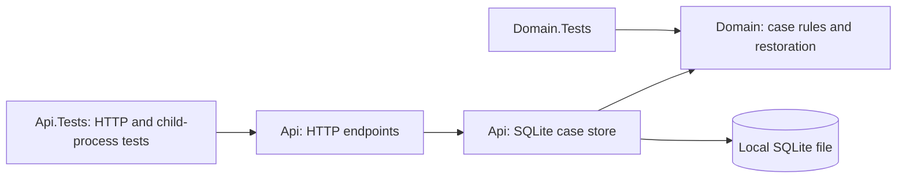
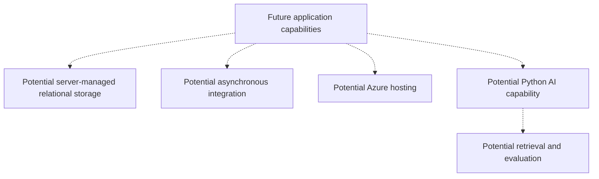

# Architecture overview

## Context and objectives

This reference project explores enterprise case modernization using generic synthetic concepts, without reproducing an employer or client system. Maintainability, evolvability, reliability, testability and explicit tradeoffs guide current choices. Production security, cloud readiness and structured observability require future work.

## Current architecture

One ASP.NET Core .NET 10 Minimal API is the only deployable application. It exposes `/`, `/health` and five case operations, including bounded case browsing, status history and optional retry-safe creation. The Api project also owns SQLite setup, access and explicit offline upgrade/inspection; Domain owns case rules and restoration. No separate persistence service or project exists.

## Boundaries and dependency direction

- **Api:** composition root, HTTP parsing/error mapping, SQLite configuration/initialization, schema checks and one concrete store per host. Provider failures remain generic `500 internal_error`; a rejected domain transition has an explicit store outcome mapped to `409 invalid_transition`.
- **Domain:** immutable ID/text, creation validation, `New → InReview → Closed` lifecycle and validated restoration of existing cases. It references no web, provider or infrastructure code. Restoration rejects damaged/unnormalized text, empty IDs and undefined statuses without defaulting or replaying transitions.
- **Tests:** Api.Tests references Api and exercises actual SQLite files, in-process HTTP hosts and real API child processes. A separate UpgradeFixture executable under `tests/` supplies a controlled clock/barrier for interruption tests, without production test switches. Frozen version-1 and version-2 fixtures remain independent of current initialization. Domain.Tests references Domain directly and needs no database.

Api references Domain. No generic repository, provider interface, ORM or additional production project is introduced. Stored mutable entities never escape for HTTP serialization; callers receive immutable four-field snapshots.

## Next persistence task: EF Core Code First

The owner has selected EF Core Code First as the preferred approach for future persistence work and conversion of the existing store. Use C# entities, `DbContext`/Fluent API configuration, LINQ/tracked writes and model-generated migrations wherever supported. The current Phase 5 runtime still uses direct `Microsoft.Data.Sqlite` access; EF adoption is [the next task](../tasks/ef-core-code-first-adoption.md), not an implemented capability.

The conversion must preserve the HTTP/domain contract, atomic history/key semantics and existing-store data while explicitly reconciling application format versions, exact schema validation and EF migration metadata. Historical ADRs describe the shipped implementation; a new compatibility amendment will document the EF transition. [Repository instructions](../../AGENTS.md) define the EF-first rule and limited SQL exceptions.

## Storage lifecycle and concurrency

An explicit `CaseStorage:DatabasePath` selects an existing local file. The separate `init-store` command exclusively reserves a new file, initializes STRICT case/history/creation-key tables and schema version 3, and exits without hosting HTTP. Any existing file is refused. Normal startup validates the exact version-3 schema, integrity, foreign keys, journaling and write access; it does not create, seed, migrate, reset or repair a store.

With hosting stopped, `upgrade-store` validates an exact version-1 or version-2 store and all source data, then upgrades directly to version 3 in one transaction. Version 1 receives honest baselines; version 2 retains every history field without reading the clock. Both add an empty binding table, leaving old cases unbound. `inspect-store` validates versions 1/2/3, including all cases, histories where present and bindings in version 3, in bounded batches within one read view. An uncertain outcome must be inspected before another mutation; version 3 means committed and a repeated upgrade is refused. No downgrade or automatic backup is supplied. See [ADR 0006](../adr/0006-bind-creation-keys-in-the-local-case-store.md), which amends the historical version-2 workflow in [ADR 0005](../adr/0005-add-status-history-with-an-explicit-store-upgrade.md).

The supported workflow is one API process per store at a time. Each operation owns a connection with pooling disabled, private cache, a finite five-second provider timeout, verified foreign-key enforcement and FULL synchronization; rollback journaling uses DELETE mode. The local directory must permit SQLite journal creation. Do not use network shares or synchronization-managed folders. See [ADR 0004](../adr/0004-use-sqlite-for-the-durable-local-workflow.md) and its Phase 4 amendment in ADR 0005.

One synchronous host gate orders operations. Creation begins a non-deferred write transaction before optional key lookup; status changes begin a non-deferred write transaction before lookup/domain validation/update. Success is returned only after commit. Reads restore and validate the row; all operations return snapshots. Request arrival order is not promised, and synchronous I/O/serialization limit concurrency.

Creation writes a `Created` entry in the same transaction as the case. Status changes validate the existing history chain, update the current status and append one `StatusChanged` entry atomically. Same-status successes add nothing and do not read the clock. Api uses framework `TimeProvider`; Domain has no clock dependency. History reads use one deferred transaction for current case and entries, ordered by case-local sequence with `LIMIT 4`: three valid entries plus a corruption sentinel. The shared validator rejects missing/invalid chains, timestamps and final-state disagreement. History is never silently truncated or repaired. Case retrieval/browsing keep their four-field representation and do not load history on every read.

Committed cases survive API restarts against the same intact file. Independent files isolate tests and demonstrations. Data has no expiration or enforced disk quota. There are no stale-client tokens, multi-instance guarantees, backups or machine power/storage-loss guarantees. A response can be lost after commit; clients can reconcile a known ID by reading it or retry creation with the same retained key/request. Keyless retries can duplicate cases. There is no fallback to memory or application transaction-retry policy.

## Creation keys and original-result replay

The create endpoint validates media type, strict JSON, domain text and an optional single quoted UUID header before I/O. The store compares normalized fields ordinally. Within its gate and one write transaction it looks up at most two matching binding rows, one case and four history rows. It validates canonical stored identifiers and the complete target chain, requiring a `Created` start. A valid equal request projects immutable ID/text with `New`; a valid differing request returns an explicit outcome mapped to `422 idempotency_key_reused`. Provider errors and damaged provenance remain generic `500`, never a false conflict or replacement.

An unbound key inserts the case, `Created` entry and binding, verifies each row count, then commits once. No pending reservation, copied response JSON, hash or separate commit exists. Replay reads no clock and changes no state. The binding table has primary-key uniqueness, unique target, canonical-key checks and a foreign key; other case operations retain their representations and do not load or change keys. The design depends on immutable text and the unchanged creation response; revisit before edits/deletion or response changes.

Bindings have no expiry, release, user/tenant scope or authorization meaning. Bounded lookup validates the selected binding; offline inspection validates all bindings in batches of 100. External deletion/rekeying can remove a lookup match and is outside the intact-owned-state guarantee. This supplies neither tamper evidence nor distributed exactly-once delivery. See the [reviewed Phase 5 contract and coverage](../requirements/phase-5-retry-safe-creation.md).

## Configuration, operability and security

The [walkthrough](../usage/local-case-workflow.md) covers initialization, normal startup, restart and disposal. The main Microsoft.Data.Sqlite package supplies the native engine through NuGet. No database server, SQLite CLI, cloud account or secret is required. Runtime files and local settings are ignored by Git; the repository contains initialization code, not a generated database.

`GET /` preserves foundation metadata; `/health` remains host liveness without storage readiness. If storage fails after startup, affected case operations fail safely. Initialization/startup storage failures produce a concise diagnostic and nonzero exit rather than dumping provider messages or configuration. There are no setup/reset/test HTTP endpoints.

All data must be synthetic. No authentication, authorization, encryption, secret-management service or production deployment is implemented. Local file access is not an application permission boundary. Future handling of sensitive records requires explicit identity, access-control, retention and data-protection requirements.

## Verification and constraints

A stable .NET 10 SDK is pinned in `global.json`, with stable feature-band roll-forward within .NET 10.0. One CI workflow enforces restore, format verification, warnings-as-errors, Release compilation and tests.

Tests cover domain rules/restoration, the complete HTTP contract, actual SQLite commits/rollback, host/file isolation, schema/startup failures and concurrent operations. A child-process test initializes storage, waits for acknowledged writes, force-kills the API and verifies state in a fresh process. Trigger/lock failures and lost-response controls live only in test fixtures. Tests use disposable directories, loopback ports assigned by the OS and bounded readiness waits; they need no machine-specific configuration or external service.

## Evolution and non-goals

[ADR 0003](../adr/0003-use-process-memory-for-the-phase-1-local-workflow.md) is retained as the superseded historical memory-store decision. [ADR 0004](../adr/0004-use-sqlite-for-the-durable-local-workflow.md) implements the [Phase 2 requirements](../requirements/phase-2-durable-case-workflow.md), preserving the [Phase 1 HTTP/domain contract](../requirements/phase-1-case-workflow.md).

Add architecture when requirements justify deployment independence, scaling, reliability, ownership, security or operational isolation. This local persistence choice does not establish an enterprise database or promise a drop-in SQL Server replacement. Revisit for shared/server storage, multi-instance hosting, measured load, audit, backups or real records.

The [implemented Phase 3 case-list requirements](../requirements/phase-3-case-list.md) add `GET /cases` to find saved work without known IDs. Query validation happens before storage access. The existing concrete store uses one parameterized SELECT under its gate, with an optional exact status filter, an exclusive canonical-ID boundary, explicit BINARY ID ordering and a `limit + 1` row bound. The existing restoration path validates every materialized row, including lookahead; the endpoint returns immutable case values and `nextAfter`, or a safe problem response.

Default pages contain up to 20 cases, with a maximum of 100. ID order is not chronological order. Each page has one consistent read view, but a traversal across requests is not a snapshot: creates/status changes can alter later membership. The continuation is a plain comparison ID, without a retained paging session or permission meaning. This bounds application materialization, not database scan work or latency.

Phase 3 changed no domain, package, schema/index/version or architecture boundary. Its list tests cover deterministic fixture ordering, query validation, failures/lookahead, changes between pages, file isolation and retained continuations after restart. Phase 4 amended the storage format through ADR 0005, preserving that list contract and the domain model.

History tests cover all lifecycle cells, safe failures, immutable prior views, controlled equal/backward clock values, rollback at both write boundaries and retained history after force-killing the API. Upgrade tests use frozen version-1 fixtures, cross batch boundaries, fail after DDL/partial baselines, and force a commit lock failure. The test-only child executable blocks on a named pipe during a real upgrade; killing it verifies old-format recovery. A separate control suppresses completion after a real commit and reconciles version 3 through inspection. Phase 5 extends these checks with UTF-8/UTF-16 source fixtures, exact version-2 history preservation, all three creation write boundaries, coordinated key races, unknown-ID response loss and keyed replay after API termination. These checks establish local process behavior, without power-loss or production audit guarantees.

## Conceptual future direction — not implemented

SQL Server / Azure SQL, Azure deployment, messaging, containers, Infrastructure as Code, identity, structured telemetry, a frontend and Python/AI remain future possibilities. No cloud service, broker or model provider is selected by this diagram; each requires concrete requirements and decisions.
