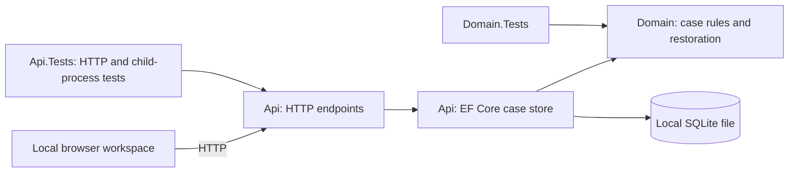
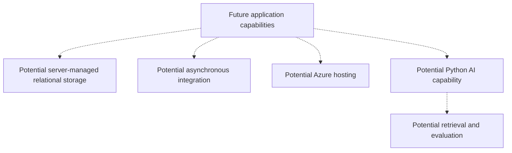

# Architecture overview

## Context and objectives

This reference project explores enterprise case modernization using generic synthetic concepts, without reproducing an employer or client system. Maintainability, evolvability, reliability, testability and explicit tradeoffs guide current choices. Production security, cloud readiness and structured observability require future work.

## Current architecture

One ASP.NET Core .NET 10 application is the only deployable. It exposes `/`, `/health` and five case operations, including bounded case browsing, status history and optional retry-safe creation, plus the `/workspace` browser UI and sign-in/session/sign-out routes. Explicit LocalDemo mode is loopback-only; configured Oidc mode adds authenticated Reader/Caseworker access. Oidc serves public HTTPS directly or through the explicit same-host proxy contract in ADR 0010. The Api project also owns the EF Core model/migrations, SQLite setup/access and explicit offline upgrade/inspection; Domain owns case rules and restoration. No separate persistence service or project exists.

## Boundaries and dependency direction

- **Api:** composition root, identity/session/authorization/CSRF, HTTP parsing/error mapping, SQLite configuration/initialization, schema checks and one concrete store per host. Provider failures remain generic `500 internal_error`; a rejected domain transition has an explicit store outcome mapped to `409 invalid_transition`.
- **Domain:** immutable ID/text, creation validation, `New → InReview → Closed` lifecycle and validated restoration of existing cases. It references no web, provider or infrastructure code. Restoration rejects damaged/unnormalized text, empty IDs and undefined statuses without defaulting or replaying transitions.
- **Tests:** Api.Tests references Api and exercises actual SQLite files, in-process HTTP hosts and real API child processes. A separate UpgradeFixture executable under `tests/` supplies a controlled clock/barrier for interruption tests, without production test switches. Frozen version-1, version-2 and version-3 fixtures remain independent of current initialization. Domain.Tests references Domain directly and needs no database.

Api references Domain and owns the EF Core persistence model and migrations. One concrete store remains in Api; no generic repository, provider interface or additional production project is introduced. Stored mutable entities never escape for HTTP serialization; callers receive immutable four-field snapshots.

## EF Core Code First

`CaseDbContext` and Fluent API define the persistence entities, relationships, keys and check constraints. The initial migration and model snapshot were scaffolded from that model. Ordinary operations use LINQ/projections or tracked writes; Domain restoration still validates materialized values. Each operation owns a context, with no context shared concurrently. A design-time factory uses in-memory SQLite only, so migration scaffolding/model checks select no user store.

[ADR 0007](../adr/0007-adopt-ef-core-code-first.md) implements the owner's [EF-first instructions](../../AGENTS.md) and documents the small remaining SQL exceptions. The SQLite provider's generated CREATE TABLE operations receive a STRICT suffix through a focused generator extension. A single-entity save verifies the actual SQLite `changes()` count because EF can report a trigger-ignored insert as a saved entity. Catalog/PRAGMA diagnostics, frozen source definitions and EF-generated legacy-baseline execution remain provider/compatibility operations.

## Storage lifecycle and concurrency

An explicit `CaseStorage:DatabasePath` selects an existing local file. The separate `init-store` command exclusively reserves a new file, initializes STRICT case/history/creation-key tables through EF migrations plus EF migration history and format 4, and exits without hosting HTTP. Any existing file is refused. Normal startup validates the exact version-4 schema/metadata, integrity, foreign keys, journaling and write access; it does not create, seed, migrate, reset or repair a store.

With hosting stopped, `upgrade-store` validates an exact version-1, version-2 or version-3 store and all its data, then adopts it directly into format 4 in one transaction. Existing application tables/values remain in place; missing tables use scaffolded migration operations. Version 1 receives honest baselines, versions 2/3 keep exact histories without reading the event clock, and version 3 retains all key bindings. Only after validated adoption is the initial EF migration baseline recorded.

The explicit offline transaction includes EF metadata and format 4; initialization suppresses only EF's warning about that caller-owned migration transaction. No persistent EF lock is acquired and no application transaction is automatically replayed. Every store user must be stopped; live/concurrent migration remains unsupported. `inspect-store` validates versions 1–4, including all cases/history/bindings and format-4 metadata. Unexpected metadata/lock tables are refused without repair. An uncertain outcome must be inspected first; valid 1/2/3 is an old source, valid 4 is committed. No downgrade or automatic backup is supplied.

Format 4 recognizes exact EF-generated definitions or exact frozen legacy application-table definitions, with provider-generated EF metadata and one known migration ID. This accepts the table combinations produced by direct adoption while rejecting arbitrary schema changes. Model/snapshot drift is rejected locally and in CI. Further migrations require an explicit compatibility/version amendment; the current adoption bridge accepts only the initial table-creation operations.

The supported workflow is one API process per store at a time. Each operation owns a context and connection with pooling disabled, private cache, a finite five-second provider timeout, verified foreign-key enforcement and FULL synchronization; rollback journaling uses DELETE mode. The local directory must permit SQLite journal creation. Do not use network shares or synchronization-managed folders. See [ADR 0004](../adr/0004-use-sqlite-for-the-durable-local-workflow.md) and its Phase 4 amendment in ADR 0005.

One synchronous host gate orders operations. Creation begins a non-deferred write transaction before optional key lookup; status changes begin a non-deferred write transaction before lookup/domain validation/update. Success is returned only after commit. Reads restore and validate the row; all operations return snapshots. Request arrival order is not promised, and synchronous I/O/serialization limit concurrency.

Creation writes a `Created` entry in the same transaction as the case. Status changes validate the existing history chain, update the current status and append one `StatusChanged` entry atomically. Same-status successes add nothing and do not read the clock. Api uses framework `TimeProvider`; Domain has no clock dependency. History reads use one deferred transaction for current case and entries, ordered by case-local sequence with `LIMIT 4`: three valid entries plus a corruption sentinel. The shared validator rejects missing/invalid chains, timestamps and final-state disagreement. History is never silently truncated or repaired. Case retrieval/browsing keep their four-field representation and do not load history on every read.

Committed cases survive API restarts against the same intact file. Independent files isolate tests and demonstrations. Data has no expiration or enforced disk quota. There are no stale-client tokens, multi-instance guarantees, backups or machine power/storage-loss guarantees. A response can be lost after commit; clients can reconcile a known ID by reading it or retry creation with the same retained key/request. Keyless retries can duplicate cases. There is no fallback to memory or application transaction-retry policy.

## Creation keys and original-result replay

The create endpoint validates media type, strict JSON, domain text and an optional single quoted UUID header before I/O. The store compares normalized fields ordinally. Within its gate and one write transaction it looks up at most two matching binding rows, one case and four history rows. It validates canonical stored identifiers and the complete target chain, requiring a `Created` start. A valid equal request projects immutable ID/text with `New`; a valid differing request returns an explicit outcome mapped to `422 idempotency_key_reused`. Provider errors and damaged provenance remain generic `500`, never a false conflict or replacement.

An unbound key inserts the case, `Created` entry and binding, verifies each row count, then commits once. No pending reservation, copied response JSON, hash or separate commit exists. Replay reads no clock and changes no state. The binding table has primary-key uniqueness, unique target, canonical-key checks and a foreign key; other case operations retain their representations and do not load or change keys. The design depends on immutable text and the unchanged creation response; revisit before edits/deletion or response changes.

Bindings have no expiry, release, user/tenant scope or authorization meaning. Bounded lookup validates the selected binding; offline inspection validates all bindings in batches of 100. External deletion/rekeying can remove a lookup match and is outside the intact-owned-state guarantee. This supplies neither tamper evidence nor distributed exactly-once delivery. See the [reviewed Phase 5 contract and coverage](../requirements/phase-5-retry-safe-creation.md).

## Configuration, operability and security

The [walkthrough](../usage/local-case-workflow.md) covers initialization, normal startup, restart and disposal. The EF Core SQLite provider and Microsoft.Data.Sqlite supply the native engine through NuGet. No database server, SQLite CLI, cloud account or real identity secret is required for LocalDemo or tests. Oidc requires private provider/session/TLS configuration. Runtime files and local settings are ignored by Git; the repository contains initialization code, not a generated database.

`GET /` preserves foundation metadata; `/health` remains host liveness without storage readiness. If storage fails after startup, affected case operations fail safely. Initialization/startup storage failures produce a concise diagnostic and nonzero exit rather than dumping provider messages or configuration. There are no setup/reset/test HTTP endpoints.

All data must be synthetic. [ADR 0009](../adr/0009-authenticate-the-shared-case-workspace.md) and the [identity runbook](../usage/authenticated-case-workspace.md) describe implemented OIDC/cookie sessions, named policies, CSRF and protected durable session keys. API denials precede case input/store access, and keys remain shared workspace-wide. Data Protection encrypts session keys/tickets, not SQLite case records. [ADR 0011](../adr/0011-use-entra-for-private-review-identity.md) selects Entra with private local role/revocation evidence; real configuration and credentials remain outside Git. No hosted secret-management service, public ingress or production deployment is established. Local file access is not an application permission boundary.

## Verification and constraints

A stable .NET 10 SDK is pinned in `global.json`, with stable feature-band roll-forward within .NET 10.0. One CI workflow enforces restore, local EF tool restore, format verification, warnings-as-errors, Release compilation, EF model/snapshot agreement and tests.

Tests cover domain rules/restoration, the complete HTTP contract, actual SQLite commits/rollback, host/file isolation, schema/startup failures and concurrent operations. A child-process test initializes storage, waits for acknowledged writes, force-kills the API and verifies state in a fresh process. Trigger/lock failures and lost-response controls live only in test fixtures. Tests use disposable directories, loopback ports assigned by the OS and bounded readiness waits; they need no machine-specific configuration or external service.

## Evolution and non-goals

[ADR 0003](../adr/0003-use-process-memory-for-the-phase-1-local-workflow.md) is retained as the superseded historical memory-store decision. [ADR 0004](../adr/0004-use-sqlite-for-the-durable-local-workflow.md) implements the [Phase 2 requirements](../requirements/phase-2-durable-case-workflow.md), preserving the [Phase 1 HTTP/domain contract](../requirements/phase-1-case-workflow.md).

Add architecture when requirements justify deployment independence, scaling, reliability, ownership, security or operational isolation. This local persistence choice does not establish an enterprise database or promise a drop-in SQL Server replacement. Revisit for shared/server storage, multi-instance hosting, measured load, audit, backups or real records.

The [implemented Phase 3 case-list requirements](../requirements/phase-3-case-list.md) add `GET /cases` to find saved work without known IDs. [Phase 7](../requirements/phase-7-case-title-search.md) amends it with optional literal case-sensitive title search. Query validation happens before storage access. The concrete EF store uses one translated LINQ query under its gate, with title/status predicates, an exclusive canonical-ID boundary, explicit BINARY ID ordering and a `limit + 1` row bound. LINQ Contains translates to a parameterized SQLite instr expression; no hand-written search SQL or schema change is needed. The existing restoration path validates every materialized row, including lookahead; the endpoint returns immutable case values and `nextAfter`, or a safe problem response. The bound covers materialization, not substring scan cost or latency.

Default pages contain up to 20 cases, with a maximum of 100. ID order is not chronological order. Each page has one consistent read view, but a traversal across requests is not a snapshot: creates/status changes can alter later membership. The continuation is a plain comparison ID, without a retained paging session or permission meaning. This bounds application materialization, not database scan work or latency.

Phase 3 changed no domain, package, schema/index/version or architecture boundary. Its list tests cover deterministic fixture ordering, query validation, failures/lookahead, changes between pages, file isolation and retained continuations after restart. Phase 4 amended the storage format through ADR 0005, preserving that list contract and the domain model.

History tests cover all lifecycle cells, safe failures, immutable prior views, controlled equal/backward clock values, rollback at both write boundaries and retained history after force-killing the API. Upgrade tests use frozen version-1 fixtures, cross batch boundaries, fail after DDL/partial baselines, and force a commit lock failure. The test-only child executable blocks on a named pipe during a real upgrade; killing it verifies old-format recovery. A separate control suppresses completion after a real commit and reconciles format 4 through inspection. Phase 5 extends these checks with UTF-8/UTF-16 source fixtures, exact history preservation, all three creation write boundaries, coordinated key races, unknown-ID response loss and keyed replay after API termination. EF adoption adds frozen version-3 bindings, migration metadata validation, STRICT enforcement and rollback of metadata from all older sources. These checks establish local process behavior, without power-loss or production audit guarantees.

## Local browser case workspace

[Phase 6](../requirements/phase-6-case-workspace.md#current-implementation-coverage) implements the browser journey: browse/filter, create, inspect current details/history and progress the existing lifecycle. [ADR 0008](../adr/0008-serve-a-local-browser-case-workspace.md) selects three embedded HTML/CSS/JavaScript assets, explicit same-host routes and no frontend build/runtime. There is no generic static directory or fallback. Browser content restrictions allow same-origin scripts/styles/connections and prohibit inline execution, frames and form navigation. Case text is rendered as text; server/proxy error bodies are never displayed.

Presentation calls only the existing API. Generation numbers discard obsolete list/detail/history responses, with independent loading/failure states and no polling. Creation freezes its quoted UUID key and payload for same-page retries; an uncertain result requires explicit acknowledgment before a replacement draft. A 15-second fetch timeout does not cancel or reconcile a server commit. Draft/key state is memory-only; status uncertainty requires current-state retrieval before another action. Mutations never display optimistic success. Details and history are separate observations, with honest upgraded-baseline labels and generic recoverable failures.

Phase 7 keeps explicit submitted title text separately from field edits. Search/Clear reset continuation; Next, status changes and list refreshes retain the submitted title. The field explains literal case-sensitive matching and reports validation separately from unavailable storage or no matches. Search terms are API query values, potentially present in HTTP diagnostics, while the workspace address and persistent browser storage remain unchanged. Existing generation checks also discard obsolete search successes/failures.

The [known-ID lookup](../tasks/open-case-by-id.md) submits only a canonical UUID to the existing detail/history routes and preserves list filters/page/continuation. Invalid input stays local; case identity is checked before display. Lookup uses the same generation checks and protected-state clearing as list selection, without changing an uncertain creation draft/key. It does not alter the workspace URL or use persistent browser storage; ordinary case-ID request paths remain observable to HTTP infrastructure.

The workspace preserves Domain and persistence boundaries, existing HTTP contracts and format 4. Microsoft.Playwright is test-only in Api.Tests; real Chromium runs against disposable stores and actual API child processes, including published output in CI. Test-side routing controls lost/delayed responses without production fault switches. The Phase 8 identity slice adds same-origin credentials, access bootstrap, Reader/Caseworker controls and clearing/invalidation on denial/sign-out. Real HTTPS browser tests use a disposable provider/test backchannel, separate from the published LocalDemo process journeys. No production impersonation route/header is supplied; network deployment acceptance remains pending.

The [project roadmap](../roadmap.md) assesses workflow value, demonstration, security, operations, integration and AI together. EF Core remains the persistence approach when a feature needs persistence; it does not determine feature priority.

## Deferred local reliability proposal — not implemented

The [storage-readiness proposal](../requirements/phase-6-storage-readiness.md) addresses the gap between a responsive host and available storage. It describes a separate `/health/ready` contract with fixed format/EF-metadata checks and a rollback-only write probe, finite work/waits and generic `200`/`503` output. It keeps `/health` storage-independent and leaves deep whole-store validation to the offline inspector. Revisit it with hosting requirements; it is no longer the next milestone. No readiness endpoint, storage-format change or monitoring deployment is implemented by the proposal.

## Secure review hosting — proposed, not implemented

[Phase 8 requirements](../requirements/phase-8-secure-hosting.md) target one invited organization/shared synthetic workspace with Reader and Caseworker grants. They require server-enforced policies, a framework-supported external OIDC/session-cookie flow, non-redirecting case API denials, JSON-write/sign-out CSRF protection and explicit expiry/recovery behavior. The identity slice now deliberately uses same-origin credentials, secure cookie sessions and antiforgery request headers. Retained creation keys stay environment-wide within the proposed shared workspace and are never authorization credentials.

The proposal joins identity, ingress, secrets/session-key storage, runtime limits, logging and backup/restore requirements. A platform/store ADR must establish compatible persistence and writer topology before deployment; ephemeral/network-shared SQLite or overlapping writers are not supported by current evidence. RPO/RTO and retention targets are proposed acceptance needs, not shipped guarantees. Readiness is revisited against the selected provider instead of automatically implementing the older SQLite-specific probe first.

The identity/session/policy runtime is implemented by ADR 0009, verified with test fixtures. [ADR 0010](../adr/0010-trust-a-single-loopback-https-proxy.md) adds a single HTTP loopback backend behind same-host HTTPS ingress, checks the original peer/protocol before processing only one forwarded HTTPS value, and retains the exact public Host. Automatic unrestricted forwarding is rejected at startup in every mode. Reader/Caseworker browser journeys also run through a real TLS-to-HTTP test proxy; no installed production proxy is certified. The [hosting assessment](../tasks/review-hosting-preparation.md) records a Linux VM/block-disk technical fit, now conditional on cost authorization. [ADR 0012](../adr/0012-gate-cloud-hosting-on-zero-recurring-cost.md) keeps review local under a zero-recurring-cost constraint while App Service F1/Azure SQL free-tier compatibility is assessed; current SQLite/loopback ingress cannot be deployed there unchanged. [ADR 0011](../adr/0011-use-entra-for-private-review-identity.md) selects Entra; private local Reader/Caseworker/unmapped-role and emergency revocation checks passed with one account. The [managed-host compatibility task](../tasks/app-service-compatibility.md) now supplies a read-only catalog checker and concrete ingress/storage/key-delivery gaps. [ADR 0013](../adr/0013-load-protection-certificates-from-private-configuration.md) now supports bounded, password-authenticated encrypted PFX material from restricted configuration while preserving the default file source and checking retained key descriptors before generation. Browser/API tests cover both sources. The [managed-ingress verification contract](../tasks/managed-ingress-verification.md) and [undeployed resource envelope](../../infra/review-probe/README.md) now define the needed edge/peer/header and credential/retention evidence; no new ingress mode is implemented. The [independent operator probe](../usage/operator-review-probe.md), selected by [ADR 0014](../adr/0014-isolate-managed-host-verification-in-an-operator-probe.md), now has local process/client evidence for private bearer access, unmodified transport observations and old-receipt retention across restart/copied artifact paths. It source-links the certificate loader and extracted framework retained-key factory without an API/Domain reference; the API preserves its discriminator, purposes and descriptor-validation behavior. The probe adds explicit initialization, a single-writer lease and strict retained-file/key-count checks. This tool does not select an application ingress mode or establish cloud acceptance. The [2026-10-29 deployment-path assessment](../tasks/free-tier-deployment-preflight.md) now identifies retained-storage permission and first-initialization gaps; private reads did not establish eligible allocation. [ADR 0015](../adr/0015-prepare-probe-storage-before-explicit-initialization.md) now adds an explicit preparation-only diagnostic phase with the same authentication and storage guards. It can run before keys/certificates exist, offers no HTTP writes, and acquires an existing exclusive lease only while verifying retained state with automatic key generation disabled. A separate operator invokes init-keys; the preparation receipt is tested after controlled promotion to normal serving/replacement. Normal startup still refuses missing keys. This resolves the local bootstrap dependency, not actual managed-storage acceptance. The [preparation-only proposal](../tasks/preparation-only-deployment-proposal.md) now fixes initial `prepare` startup in the undeployed envelope, with negative checks against startup initialization/normal serving and an explicit private release/removal manifest. Refreshed private reads still do not establish eligible allocation; exact eligibility/policy evidence precedes any creation decision. Actual free-tier delivery/retention, ingress, provider, region and operating design still require proof before remaining hosted identity/user checks. No compute resource, server database or public deployment topology is provisioned/verified. Domain remains independent, and EF Code First/offline compatibility requirements continue to apply when persistence changes are needed.

## Conceptual future direction — not implemented

SQL Server / Azure SQL, Azure deployment, messaging, containers, operational infrastructure/release automation, restricted structured telemetry and Python/AI remain future possibilities. No cloud service, broker or model provider is selected by this diagram; each requires concrete requirements and decisions.
