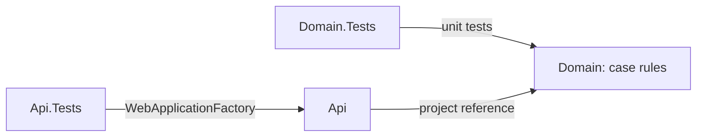
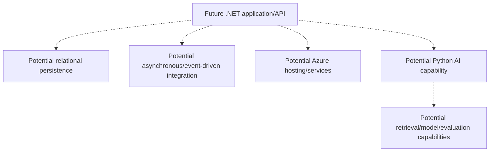

# Architecture overview

## Context

Enterprise case modernization can involve fragmented legacy processes, information boundaries and manual coordination. This reference project uses generic synthetic concepts. It does not reproduce any employer's or client's system.

## Architecture Objectives

Maintainability, evolvability, security, reliability and testability guide current choices. Cloud readiness and structured observability are future objectives. Decisions should expose their tradeoffs rather than assume theoretical scale.

## Current Architecture

One ASP.NET Core .NET 10 Minimal API is the only deployable application. It returns foundation metadata at `/` and uses the framework's health-check infrastructure at `/health`. Integration tests run the real application in an in-memory host.

The Domain library implements case creation, text validation and the `New → InReview → Closed` lifecycle. Focused unit tests exercise these rules directly. The API references Domain but does not yet expose case operations or store cases.

## Current Boundaries

- **Api:** composition root, dependency injection, HTTP hosting and the two foundation endpoints. Case HTTP operations remain planned.
- **Domain:** a `Case` model and `CaseStatus` enum. Creation generates an identifier, trims and validates required text and starts the case in `New`. Identifier and text are immutable. Status can move forward or remain unchanged; invalid values/transitions are rejected before mutation.

The domain uses standard argument exceptions for invalid input and `InvalidOperationException` for a disallowed transition. These contain no submitted case text. HTTP error mapping belongs to the future API implementation; the domain does not know HTTP status codes or problem details.

## Dependency Direction

Api references Domain. Api.Tests references Api. Domain.Tests references Domain directly. Domain references neither Api nor tests and has no web, storage or infrastructure dependencies. Additional boundaries will be introduced only when actual implementation needs them.

## Constraints

The foundation and this first domain slice use no external infrastructure, secrets or real business data. The SDK is pinned to an installed stable .NET 10 baseline, with stable feature-band roll-forward within .NET 10.0. SLNX is created through normal CLI tooling. One CI workflow enforces formatting, warnings-as-errors, Release compilation and tests.

## Assumptions

These are working assumptions, not proven requirements:

- A case-centric use case will be small enough to begin in one application.
- Relational persistence may suit future transactional requirements.
- Integration and AI capabilities may eventually justify specialized components.

Each assumption will be revisited with concrete requirements and evidence.

## Non-goals

This slice does not implement case HTTP workflows, storage/persistence, cloud resources, containers, messaging, identity, authorization, a frontend, Python services, AI, production deployment or telemetry integration. It does not define a distributed system or promise a final modular-monolith topology.

## Security Principles

- No secrets, real case records, personal information or confidential material in source or contributions.
- Minimize exposed metadata; no environment, machine, build or host identifiers.
- Prefer secure defaults and least privilege; CI has read-only repository permissions.
- Future authorization and data-access boundaries must be designed before handling sensitive information.

The present API is a local foundation without authentication. These principles do not constitute implemented production security controls.

## Operability Principles

Framework health checks and automated build/test gates exist now. The health endpoint checks no external dependencies and reports host health only. Structured observability, dependency readiness checks and reproducible deployment are future work, to be defined alongside real infrastructure.

## Evolution Philosophy

Start with one small deployable application and explicit internal boundaries. Add abstractions, processes or independent services when requirements justify deployment independence, scaling differences, reliability, ownership, security or operational isolation. Avoid optimizing for hypothetical scale. Record meaningful decisions in [ADRs](../adr/README.md).

The [reviewed Phase 1 requirements](../requirements/phase-1-case-workflow.md) distinguish implemented domain behavior from planned HTTP operations. The next decision is the minimum storage approach and its lifetime/isolation limits; no store or persistence interface is selected yet.

## Conceptual Future Direction — Not Yet Implemented

The following relationships are possibilities, not selected services or deployed components:

No cloud service, database product, broker or model provider is committed by this diagram. SQL Server / Azure SQL may be evaluated for future persistence. Infrastructure as Code, identity, observability, AI evaluation and human approval boundaries require future requirements and decisions.
