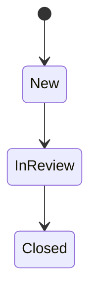

# Phase 1 requirements: synthetic case workflow

**Status: Reviewed requirements — local workflow implemented.**

This document preserves the Phase 1 HTTP/domain contract and its original temporary-memory assumptions. The contract remains implemented and tested. [Phase 2](phase-2-durable-case-workflow.md) now replaces those storage assumptions with retained local SQLite storage; production capabilities remain deferred. See the [current architecture](../architecture/overview.md) and [application-boundary decision](../adr/0002-start-with-a-modular-application-boundary.md).

## Purpose and scenario

A fictional internal service desk receives requests to correct example documentation. A staff member creates a case, starts reviewing it and closes it when the request has been handled. For example, a synthetic request might be titled “Correct the sample onboarding guide.”

This scenario introduces a small lifecycle and validation rules without borrowing an employer's process, records or terminology. The intended outcome is a testable domain model and a small HTTP workflow.

## Actor and assumptions

- **Staff member:** the conceptual user who creates, reads and progresses a case. This is a scenario actor, not an implemented identity or authorization role.
- All input is synthetic. There are no customer records, people, attachments or confidential documents.
- The first implementation is a local demonstration. Its API contract must be demonstrable within one running application instance.
- Durable storage, restart recovery, multi-instance operation and stale-client conflict detection are outside this first slice. [ADR 0003](../adr/0003-use-process-memory-for-the-phase-1-local-workflow.md) defines synchronized in-process operations and host-owned storage for the implemented local workflow.
- These are proposed product assumptions for this reference project, not validated enterprise requirements.

## Scope

The slice supports creating one case, retrieving it by identifier and progressing its status. Each operation acts on a single case. Data exists only for the lifetime of its application host.

Out of scope: listing/search/pagination, editing case text, deletion, assignment, priorities, comments, attachments, reopening, cancellation, approvals, audit history, notifications and external integrations. Database implementation was deferred in Phase 1 and is now covered separately by Phase 2. Azure, messaging, Python/AI, authentication/authorization, frontend, infrastructure and observability integrations remain deferred.

## Minimum case data

| Field | Ownership and rule |
| --- | --- |
| `id` | Server-generated non-empty UUID; immutable. Exposed as a canonical hyphenated UUID string. |
| `title` | Required string; trim surrounding whitespace; length 1–120 after trimming. |
| `description` | Required string; trim surrounding whitespace; length 1–2,000 after trimming. |
| `status` | Server-controlled lifecycle state. Initially `New`; changed only through the status operation. |

Length limits use .NET string length after trimming. Null, missing, non-string and whitespace-only title/description values are invalid. Preserve internal whitespace. No timestamps, user identifiers or external references are required in this slice.

Clients cannot supply an identifier or initial status. Creation accepts only `title` and `description`; unknown properties are rejected. Property names are case-sensitive and duplicate properties are rejected to avoid ambiguous input. Distinct successful create requests produce distinct identifiers, even when the text is identical. Duplicate detection and retry/idempotency keys are deferred.

## Lifecycle rules

The implemented domain lifecycle is:



`Closed` is terminal. A case cannot skip review or move backward. Requesting its current status succeeds without changing it, so repeating a successful status request is safe.

The complete transition matrix is the business rule:

| Current state → requested state | `New` | `InReview` | `Closed` |
| --- | --- | --- | --- |
| `New` | Unchanged; success | Allowed | Rejected |
| `InReview` | Rejected | Unchanged; success | Allowed |
| `Closed` | Rejected | Rejected | Unchanged; success |

A successful transition preserves the case identifier, title and description. An invalid operation must leave the entire case unchanged. Status input accepts exactly the strings `New`, `InReview` and `Closed`; numeric, null, unknown or differently cased values are invalid.

## HTTP contract

**The routes below are implemented.** The existing `GET /` and `GET /health` retain their foundation behavior.

| Operation | Request | Successful response |
| --- | --- | --- |
| Create | `POST /cases` with `title` and `description` | `201 Created`; complete case representation; `Location: /cases/{id}` |
| Retrieve | `GET /cases/{id}` | `200 OK`; complete case representation |
| Change status | `PUT /cases/{id}/status` with only `status` | `200 OK`; complete case representation, including for an unchanged status |

Request and response fields use camelCase. Writes accept UTF-8 `application/json` (charset absent or `utf-8`); successful bodies use `application/json`. Other media types and charsets are unsupported. A case representation contains exactly the four fields above. IDs in route segments must be non-empty canonical hyphenated UUIDs.

Example create request, containing synthetic text only:

```json
{
  "title": "Correct the sample onboarding guide",
  "description": "Update the fictional example section in the demonstration guide."
}
```

Example status request after creation:

```json
{
  "status": "InReview"
}
```

The server generates the actual identifier. A client can follow the returned `Location` to retrieve the created case. A later valid request can change `InReview` to `Closed`.

### Validation and failures

Reject unsupported content types before parsing JSON. Validate the route identifier and request shape/fields before looking up a case. Look up the case before evaluating a transition. For a request with multiple validation errors, the exact message wording and ordering are not part of the contract.

| Condition | HTTP status | Stable problem `code` |
| --- | --- | --- |
| Invalid or all-zero route UUID; empty, malformed or non-object JSON, including invalid Unicode; missing, invalid, duplicate or unknown fields | `400 Bad Request` | `validation_failed` |
| Valid request/identifier but no matching case | `404 Not Found` | `case_not_found` |
| Known case and recognized status, but transition rejected by the matrix | `409 Conflict` | `invalid_transition` |
| A write uses an unsupported content type or charset | `415 Unsupported Media Type` | `unsupported_media_type` |
| An unexpected application failure | `500 Internal Server Error` | `internal_error` |

Failures use `application/problem+json` with standard problem fields `type`, `title` and `status`, plus the stable `code` above. `about:blank` is sufficient for `type`; use the corresponding HTTP reason phrase for `title`. No hosted error-documentation service is required. Field-validation problems also include an `errors` object keyed by the relevant request field; route and body-level failures may use `id` and `body` respectively.

Do not include submitted text, stack traces, host/environment metadata, credentials or internal implementation details in problem responses. Failed writes must neither create a partial case nor alter an existing case. A well-formed request for a missing case returns `404` regardless of whether its requested transition would be legal for another case.

HTTP method/status semantics use [RFC 9110](https://www.rfc-editor.org/rfc/rfc9110.html); problem responses use [RFC 9457](https://www.rfc-editor.org/rfc/rfc9457.html).

### Concurrency and durability limits

The workflow criteria below describe operations in one running instance. [ADR 0003](../adr/0003-use-process-memory-for-the-phase-1-local-workflow.md) defines the historical Phase 1 store: it starts empty, serializes operations under one gate and returns immutable snapshots. All data is lost when that host ends and is never shared with another host. No durable recovery, stale-client/version-token protection, enforced memory cap or promised concurrent request arrival order is provided. Current storage/recovery behavior is defined and tested under Phase 2 and ADR 0004.

## Acceptance criteria

These criteria describe the **implemented local workflow**. Domain tests, store tests and isolated-host integration tests cover them as detailed below.

| ID | Given / when | Expected result |
| --- | --- | --- |
| AC-01 | Create with valid title and description | Unique non-empty ID; status `New`; `201`; four-field representation; usable `Location`. |
| AC-02 | Create with leading/trailing whitespace | Stored/returned text is trimmed; internal whitespace is preserved. |
| AC-03 | Create with title lengths 1/120 and description lengths 1/2,000 after trimming | Boundary values succeed. Each field independently rejects its maximum plus one. |
| AC-04 | Create with missing, null, non-string or whitespace-only title/description | `400` with `validation_failed` and field errors; no case is created. |
| AC-05 | Create with supplied `id`, `status` or another unknown property | `400`; server-owned fields cannot be injected. |
| AC-06 | Retrieve a successfully created case through its `Location` | `200`; same ID, normalized text and current status; no extra metadata. |
| AC-07 | Request any case route with an invalid or all-zero UUID, or a valid UUID with no case | Invalid ID: `400`; valid missing ID: `404`. |
| AC-08 | Change `New` → `InReview`, then `InReview` → `Closed` | Both return `200`; a subsequent read observes each status; all other fields remain unchanged. |
| AC-09 | Exercise every rejected cell in the transition matrix | `409` with `invalid_transition`; subsequent read proves no mutation. |
| AC-10 | Request each state's current status, including immediately repeating a successful transition request | `200`; unchanged representation; no additional transition. |
| AC-11 | Submit missing, null, numeric, unknown or differently cased status, or extra fields | `400`; no mutation. |
| AC-12 | Send a well-formed status request for a missing case | `404` with `case_not_found`; no case is created. |
| AC-13 | Send an empty/malformed/non-object body as `application/json`, or use an unsupported write content type | JSON/body errors: `400`; unsupported content type: `415`; structured problem body; no mutation. |
| AC-14 | Create two cases with identical text and update only one | Distinct IDs; changing one leaves the other unchanged. |
| AC-15 | Exercise the specified failure responses | Problem media type, status and code agree; field errors appear where required; submitted text and internal details are absent. |
| AC-16 | Run the existing root and health integration tests | Existing Phase 0 behavior remains intact. |

## Current implementation coverage

| Criteria | Evidence |
| --- | --- |
| AC-01–05 | [Creation tests](../../tests/EnterpriseCaseIntelligence.Api.Tests/Cases/CaseCreationEndpointTests.cs): ID/Location/representation, normalization, boundaries, required types and server-owned/unknown-field rejection |
| AC-06–07, AC-12 | [Lookup/isolation tests](../../tests/EnterpriseCaseIntelligence.Api.Tests/Cases/CaseLookupAndIsolationTests.cs): retrieval, route validation, missing cases and validation-before-lookup |
| AC-08–11 | [Status tests](../../tests/EnterpriseCaseIntelligence.Api.Tests/Cases/CaseStatusEndpointTests.cs): every matrix cell, no-op retries, strict status input and unchanged state after rejection |
| AC-13–15 | Creation/status tests cover body/media-type failures, independent cases and safe problem responses; [storage failure tests](../../tests/EnterpriseCaseIntelligence.Api.Tests/Cases/CaseStorageFailureTests.cs) checks generic fallback behavior |
| AC-16 | Existing [root](../../tests/EnterpriseCaseIntelligence.Api.Tests/RootEndpointTests.cs) and [health](../../tests/EnterpriseCaseIntelligence.Api.Tests/HealthEndpointTests.cs) tests |
| Current storage, ADR 0004 | [Durability tests](../../tests/EnterpriseCaseIntelligence.Api.Tests/Cases/CaseDurabilityTests.cs) cover immutable snapshots, committed state and restart continuity; Phase 2 supersedes the old data-loss behavior |

[Domain tests](../../tests/EnterpriseCaseIntelligence.Domain.Tests) remain independent of HTTP/storage. The API exposes the three case operations plus `/` and `/health`. See the [local walkthrough](../usage/local-case-workflow.md) for a manual create/read/transition sequence.

## Verification approach

- Test domain normalization, field boundaries and all nine transition-matrix cells independently of HTTP and storage.
- Use `WebApplicationFactory<Program>` integration tests for routes, JSON/media types, `Location`, error mapping and the create/read/transition/read sequence.
- Give tests isolated state; avoid execution-order dependence and shared static case data. No external service, secret or machine-specific configuration may be needed.
- Keep format verification, warnings-as-errors, Release build and tests in CI.

The Domain.Tests project uses the same xUnit/VSTest tooling as the API tests. No new testing framework is introduced.

## Implementation sequence and decision gates

1. **Reviewed:** the three-state lifecycle, text limits and absence of durable-storage requirements are the baseline for this slice. Amend the document when product assumptions change.
2. **Implemented:** domain rules and focused tests. Domain remains independent of HTTP, storage and infrastructure.
3. **Historical, superseded by ADR 0004:** [ADR 0003](../adr/0003-use-process-memory-for-the-phase-1-local-workflow.md) records the local storage approach, lifetime/isolation limits and mutation semantics.
4. **Implemented:** the three case operations and their acceptance tests, with existing foundation endpoints preserved.

The local workflow is implemented. Phase 2 and ADR 0004 now add durable local persistence while retaining this HTTP/domain contract. External integrations and production deployment still require separate requirements and decisions.
