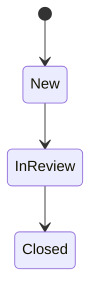

# Phase 1 proposal: synthetic case workflow

**Status: Proposed requirements — not implemented.**

The application remains at **Foundation / Phase 0**. This document proposes the first business behavior to implement after review; it does not claim that case endpoints, models or storage exist. See the [current architecture](../architecture/overview.md) and [application-boundary decision](../adr/0002-start-with-a-modular-application-boundary.md).

## Purpose and scenario

A fictional internal service desk receives requests to correct example documentation. A staff member creates a case, starts reviewing it and closes it when the request has been handled. For example, a synthetic request might be titled “Correct the sample onboarding guide.”

This scenario introduces a small lifecycle and validation rules without borrowing an employer's process, records or terminology. The intended outcome is a testable domain model and a small HTTP workflow.

## Actor and assumptions

- **Staff member:** the conceptual user who creates, reads and progresses a case. This is a scenario actor, not an implemented identity or authorization role.
- All input is synthetic. There are no customer records, people, attachments or confidential documents.
- The first implementation is a local demonstration. Its API contract must be demonstrable within one running application instance.
- Durable storage, restart recovery, multi-instance operation and concurrent-writer guarantees are not requirements of this first slice. A storage approach still needs a decision before case endpoints are implemented.
- These are proposed product assumptions for this reference project, not validated enterprise requirements.

## Scope

The proposed slice supports creating one case, retrieving it by identifier and progressing its status. Each operation acts on a single case.

Out of scope: listing/search/pagination, editing case text, deletion, assignment, priorities, comments, attachments, reopening, cancellation, approvals, audit history, notifications and external integrations. Database implementation, Azure, messaging, Python/AI, authentication/authorization, frontend, infrastructure and observability integrations remain deferred.

## Minimum case data

| Field | Ownership and rule |
| --- | --- |
| `id` | Server-generated non-empty UUID; immutable. Exposed as a canonical hyphenated UUID string. |
| `title` | Required string; trim surrounding whitespace; length 1–120 after trimming. |
| `description` | Required string; trim surrounding whitespace; length 1–2,000 after trimming. |
| `status` | Server-controlled lifecycle state. Initially `New`; changed only through the status operation. |

Length limits use .NET string length after trimming. Null, missing, non-string and whitespace-only title/description values are invalid. Preserve internal whitespace. No timestamps, user identifiers or external references are required in this slice.

Clients cannot supply an identifier or initial status. Creation accepts only `title` and `description`; unknown properties are rejected. Distinct successful create requests produce distinct identifiers, even when the text is identical. Duplicate detection and retry/idempotency keys are deferred.

## Lifecycle rules

The proposed forward lifecycle is:



`Closed` is terminal. A case cannot skip review or move backward. Requesting its current status succeeds without changing it, so repeating a successful status request is safe.

The complete transition matrix is the business rule:

| Current state → requested state | `New` | `InReview` | `Closed` |
| --- | --- | --- | --- |
| `New` | Unchanged; success | Allowed | Rejected |
| `InReview` | Rejected | Unchanged; success | Allowed |
| `Closed` | Rejected | Rejected | Unchanged; success |

A successful transition preserves the case identifier, title and description. An invalid operation must leave the entire case unchanged. Status input accepts exactly the strings `New`, `InReview` and `Closed`; numeric, null, unknown or differently cased values are invalid.

## Proposed HTTP contract

**All routes below are planned.** The existing `GET /` and `GET /health` retain their Phase 0 behavior.

| Operation | Request | Successful response |
| --- | --- | --- |
| Create | `POST /cases` with `title` and `description` | `201 Created`; complete case representation; `Location: /cases/{id}` |
| Retrieve | `GET /cases/{id}` | `200 OK`; complete case representation |
| Change status | `PUT /cases/{id}/status` with only `status` | `200 OK`; complete case representation, including for an unchanged status |

Request and response fields use camelCase. Writes accept `application/json`; successful bodies use `application/json`. A case representation contains exactly the four fields above. IDs in route segments must be non-empty canonical hyphenated UUIDs.

Example create request, containing synthetic text only:

```json
{
  "title": "Correct the sample onboarding guide",
  "description": "Update the fictional example section in the demonstration guide."
}
```

Example status request after creation:

```json
{
  "status": "InReview"
}
```

The server generates the actual identifier. A client can follow the returned `Location` to retrieve the created case. A later valid request can change `InReview` to `Closed`.

### Validation and failures

Reject unsupported content types before parsing JSON. Validate the route identifier and request shape/fields before looking up a case. Look up the case before evaluating a transition. For a request with multiple validation errors, the exact message wording and ordering are not part of the contract.

| Condition | HTTP status | Stable problem `code` |
| --- | --- | --- |
| Invalid or all-zero route UUID; empty, malformed or non-object JSON; missing, invalid or unknown fields | `400 Bad Request` | `validation_failed` |
| Valid request/identifier but no matching case | `404 Not Found` | `case_not_found` |
| Known case and recognized status, but transition rejected by the matrix | `409 Conflict` | `invalid_transition` |
| A write uses an unsupported content type | `415 Unsupported Media Type` | `unsupported_media_type` |

Failures use `application/problem+json` with standard problem fields `type`, `title` and `status`, plus the stable `code` above. `about:blank` is sufficient for `type`; use the corresponding HTTP reason phrase for `title`. No hosted error-documentation service is required. Field-validation problems also include an `errors` object keyed by the relevant request field; route and body-level failures may use `id` and `body` respectively.

Do not include submitted text, stack traces, host/environment metadata, credentials or internal implementation details in problem responses. Failed writes must neither create a partial case nor alter an existing case. A well-formed request for a missing case returns `404` regardless of whether its requested transition would be legal for another case.

HTTP method/status semantics use [RFC 9110](https://www.rfc-editor.org/rfc/rfc9110.html); problem responses use [RFC 9457](https://www.rfc-editor.org/rfc/rfc9457.html).

### Concurrency and durability limits

The acceptance scenarios below describe sequential operations in one running instance. The slice does not promise protection from stale client writes or durable recovery. Choose and document storage lifetime, mutation behavior and limitations before implementing the HTTP operations. An in-memory demonstration would require explicit documentation that data disappears on restart and is not shared between instances. No store, interface or database is selected or scaffolded by this proposal.

## Acceptance criteria

These are criteria for the **future implementation**. This documentation change does not satisfy them by adding executable behavior.

| ID | Given / when | Expected result |
| --- | --- | --- |
| AC-01 | Create with valid title and description | Unique non-empty ID; status `New`; `201`; four-field representation; usable `Location`. |
| AC-02 | Create with leading/trailing whitespace | Stored/returned text is trimmed; internal whitespace is preserved. |
| AC-03 | Create with title lengths 1/120 and description lengths 1/2,000 after trimming | Boundary values succeed. Each field independently rejects its maximum plus one. |
| AC-04 | Create with missing, null, non-string or whitespace-only title/description | `400` with `validation_failed` and field errors; no case is created. |
| AC-05 | Create with supplied `id`, `status` or another unknown property | `400`; server-owned fields cannot be injected. |
| AC-06 | Retrieve a successfully created case through its `Location` | `200`; same ID, normalized text and current status; no extra metadata. |
| AC-07 | Request any case route with an invalid or all-zero UUID, or a valid UUID with no case | Invalid ID: `400`; valid missing ID: `404`. |
| AC-08 | Change `New` → `InReview`, then `InReview` → `Closed` | Both return `200`; a subsequent read observes each status; all other fields remain unchanged. |
| AC-09 | Exercise every rejected cell in the transition matrix | `409` with `invalid_transition`; subsequent read proves no mutation. |
| AC-10 | Request each state's current status, including immediately repeating a successful transition request | `200`; unchanged representation; no additional transition. |
| AC-11 | Submit missing, null, numeric, unknown or differently cased status, or extra fields | `400`; no mutation. |
| AC-12 | Send a well-formed status request for a missing case | `404` with `case_not_found`; no case is created. |
| AC-13 | Send an empty/malformed/non-object body as `application/json`, or use an unsupported write content type | JSON/body errors: `400`; unsupported content type: `415`; structured problem body; no mutation. |
| AC-14 | Create two cases with identical text and update only one | Distinct IDs; changing one leaves the other unchanged. |
| AC-15 | Exercise the specified failure responses | Problem media type, status and code agree; field errors appear where required; submitted text and internal details are absent. |
| AC-16 | Run the existing root and health integration tests | Existing Phase 0 behavior remains intact. |

## Verification approach for implementation

- Test domain normalization, field boundaries and all nine transition-matrix cells independently of HTTP and storage.
- Use `WebApplicationFactory<Program>` integration tests for routes, JSON/media types, `Location`, error mapping and the create/read/transition/read sequence.
- Give tests isolated state; avoid execution-order dependence and shared static case data. No external service, secret or machine-specific configuration may be needed.
- Keep format verification, warnings-as-errors, Release build and tests in CI.

No new test framework or test project is introduced by this requirements change. Focused domain tests can be added when domain behavior is implemented.

## Implementation sequence and decision gates

1. Review this proposal, especially the three-state lifecycle, text limits and lack of durable-storage requirements. Amend the document when product assumptions change.
2. Implement the agreed domain rules and focused tests. Keep Domain independent of HTTP, storage and infrastructure. This is the next coding task.
3. Decide the minimum storage approach needed for the local workflow. Record a meaningful architecture choice in an ADR before adding storage-dependent endpoints. Define concrete lifetime, isolation and mutation semantics; do not create speculative layers.
4. Implement only the proposed case operations and integration criteria after that decision. Keep existing endpoints intact and update documentation to distinguish completed behavior from remaining plans.

Completion of this requirements task means that the proposal, HTTP contract, acceptance criteria and deferred decisions are documented and linked. Completion of the future workflow requires the agreed criteria to pass in executable tests; a written proposal alone is not implemented functionality.
