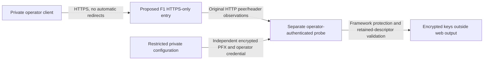

# Verify managed ingress and protected-key delivery

**Status: independent operator probe implemented/tested locally; trust contract and undeployed resource envelope prepared; runtime/platform acceptance unverified.** No App Service ingress mode, cloud resource, case-store provider or production authentication shortcut is introduced. [ADR 0012](../adr/0012-gate-cloud-hosting-on-zero-recurring-cost.md)'s $0 recurring-cost boundary and [ADR 0013](../adr/0013-load-protection-certificates-from-private-configuration.md)'s protection rules remain.

The [2026-10-29 deployment-path assessment](free-tier-deployment-preflight.md) now identifies retained-storage permissions and explicit first-initialization as blockers before creation review. Private reads have not established eligible allocation. [ADR 0015](../adr/0015-prepare-probe-storage-before-explicit-initialization.md) now implements a guarded local preparation/initialization sequence and defines a preparation-only diagnostic boundary. Complete exact private eligibility and a concrete preparation-only proposal before any creation decision; actual platform isolation/storage remain unverified.

## Trust contract to prove

App Service documents upstream TLS termination and forwarded request information. The current direct-HTTPS and same-host loopback contracts do not establish trust in that platform path. Broad private-network examples are not evidence for this application's backend isolation or header normalization. [Platform HTTPS guidance](https://learn.microsoft.com/en-us/azure/app-service/configure-language-dotnetcore#detect-https-session), [proxy trust guidance](https://learn.microsoft.com/en-us/aspnet/core/host-and-deploy/proxy-load-balancer?view=aspnetcore-10.0).

| Boundary | Required contract and evidence |
| --- | --- |
| Public entry | One privately recorded default HTTPS hostname, read from the actual site's control-plane properties rather than constructed from a naming assumption. Explicit HTTPS-only and minimum TLS on both site and SCM. HTTP plus forged HTTPS headers must not reach protected application work. |
| Physical backend | Record original scheme and TCP peer **before** forwarding middleware. Prove the worker listener is not directly reachable outside the intended platform path. A website/environment marker or a request header does not prove this boundary. |
| Trusted peers | A candidate explicit mode would pin a bounded set of literal transport-peer addresses, normalized for IPv4-mapped IPv6. No automatic discovery from requests, blanket private CIDRs, cleared proxy allowlist or unrestricted forwarding flag. A worker/peer change must fail closed until privately reverified. If churn makes this impractical, the design remains blocked; do not silently widen trust. |
| Scheme and host | After original-peer verification, consume only one canonical `X-Forwarded-Proto: https`; require the exact configured public Host/port. Do not consume forwarded host/prefix or a caller-selected origin. Reject conflicting `Forwarded`, forwarded-host/prefix values under the candidate contract. Observe whether the real platform supplies those headers before selecting a mode. |
| Client-address chains | Do not consume `X-Forwarded-For` or use it for grants. Record only header presence/cardinality privately. On real HTTPS, forged inputs must be either normalized by the trusted edge or rejected; they cannot alter the callback/host/security decision. A normalized header on actual TLS is not itself a bypass. |
| Identity and writes | Keep actual OIDC signature/issuer/audience/state/nonce checks, projected Reader/Caseworker grants, cookie isolation/deadline, CSRF and denial precedence. ARR/client-principal/role headers are not case identity. The public callback stays derived from configured PublicOrigin. |

These are acceptance requirements, not implemented runtime settings. Do not configure `Security:Ingress=AppService` or a guessed peer range: the application still supports only its existing modes. A future ingress ADR/implementation needs the actual evidence, adversarial tests and the same retained-data guarantees.

## Minimal probe, separate from the case application

Use a dedicated, temporary .NET 10 operator probe to gather the missing evidence. The [independent probe and private runbook](../usage/operator-review-probe.md), recorded by [ADR 0014](../adr/0014-isolate-managed-host-verification-in-an-operator-probe.md), now implement this tool locally. It is built/published separately from the case API and is not included in the resource envelope. It contains no case/database routes, OIDC registration, real reviewer identity or shortcut that bypasses the case API's startup/security validation.

The probe must require a dedicated high-entropy operator credential supplied through restricted configuration, with bounded constant-time comparison and no token in URLs/logs. No cookies, public registration, production impersonation route, arbitrary file access or configuration-dump endpoint. The [explicit preparation sequence](../usage/operator-review-probe.md#explicit-preparation-and-initialization) can inspect metadata before importing protection material, then verify retained state with automatic generation disabled after the separate operator initializer runs. It offers no HTTP initialization or permission bypass. The operator client must validate ordinary TLS and refuse cross-origin/automatic redirects; LocalDemo must never be exposed as a probe. Use an independently generated disposable protection certificate, environment/revision and key ring, never the private local-review credentials or keys.

Return only bounded observations needed by the operator: original scheme/peer, Host-match flag, forwarding-header classification/cardinality and a purpose-bound opaque protection receipt. Peer/hostname/receipt/trace details stay in an operator-controlled location outside Git. Publish only outcome summaries. Use the same framework certificate/protection logic as the application; do not invent encryption or infer persistence merely because a directory exists.

## Credential delivery and retention procedure

1. Before any creation, use the locally tested independent probe, review the [resource envelope](../../infra/review-probe/README.md), privately verify exact F1 eligibility/quotas and obtain the owner's explicit decision for that concrete proposal. Use a fresh isolated group. No credit-funded or paid-tier fallback, SQL, Key Vault, monitoring add-on or custom domain is implied.
2. Keep deployment/SCM/FTP basic authentication disabled. Use an authorized Entra/RBAC operator and supported tooling; inability to deploy/initialize through the free authenticated path is a failed gate, not permission to enable basic publishing or upgrade. [Deployment authentication](https://learn.microsoft.com/en-us/azure/app-service/configure-basic-auth-disable).
3. Prepare the encrypted PFX/password and independent probe credential in a permission-restricted private configuration file (owner-only file, restricted directory). Use the existing `CertificateSource=Configuration` contract, omit CertificatePath, and supply all related settings in one controlled update. Do not pass values as command arguments, print app settings, enable CLI debug/request tracing, or include secrets in ARM parameters/outputs/artifacts. App settings' platform encryption does not remove operator/process access to their values. [App settings behavior](https://learn.microsoft.com/en-us/azure/app-service/configure-common#configure-app-settings).
4. Use the [locally tested preparation sequence](../usage/operator-review-probe.md#explicit-preparation-and-initialization), preserving the [storage acceptance boundary](free-tier-deployment-preflight.md#blocker-1-retained-storage-and-permission-semantics); the following is still a required cloud outcome, not deployed evidence. Explicitly initialize the probe's retained key directory through the approved operator path, outside `/home/site/wwwroot` and release/temporary paths. Never auto-initialize a missing mount/directory on restart. `/home` persistence and access isolation must be observed on the actual F1 code host; shared storage may be appropriate for framework key files but does not validate SQLite there. Verify credentials/configuration permissions and ordinary deployment tooling as part of this step. [Storage behavior](https://learn.microsoft.com/en-us/azure/app-service/configure-custom-container#use-persistent-shared-storage).
5. Obtain an opaque protection receipt and private hashes/counts of encrypted key files. Restart the sole probe process, then deploy a replacement probe artifact without overlapping writers, keeping the same credential/environment/revision/key directory. The old receipt must unprotect and keys remain encrypted/retained; a fresh successful round trip alone is insufficient evidence.
6. Test an invalid password, incompatible valid certificate, missing directory and intentional revision change against the disposable environment. Invalid credentials must not replace keys or initialize state. Restore the original credential and verify the old receipt when appropriate; a deliberate revision change must reject it. Keep corruption/failure controls in tests/operator steps, never production case endpoints.
7. Record artifact/commit, UTC times, exact tested configuration privately, ordinary/forged-header outcomes, same-key restart/release results and remaining gaps. Review and retire only the dedicated probe resources through an explicit operator action, retaining/restricting the private evidence/key archive as needed. Do not delete unrelated groups or the local review store/keys. No scheduled cleanup or automation is created by this plan.

## Evidence and decision gates

| Gate | Evidence required; current state |
| --- | --- |
| MI-01 | Offline envelope check and negative cost/security tests pass. This covers only the proposed template, not Azure acceptance/eligibility. |
| MI-02 | Authorized cloud validation and exact free SKU/ancillary-resource review; owner-approved creation. **Guarded preparation/initialization locally tested; exact eligibility, a complete preparation-only proposal and owner approval pending. Actual storage/isolation must pass before initialization.** |
| MI-03 | Legitimate HTTPS and HTTP-with-forged-forwarding requests establish the actual edge/backend fence. **Pending.** |
| MI-04 | Missing/multiple/conflicting forwarding headers and forged Host/client-principal inputs cannot change the origin or grant access. **Pending.** |
| MI-05 | Observed original peers can support a bounded explicit allowlist across restart/replacement, or the mode remains unsupported. **Pending.** |
| MI-06 | Configuration delivery, access permissions, private material hygiene, encrypted keys and old-receipt retention pass restart/release. **Local process/configuration and copied-artifact retention tests pass; actual F1 delivery/permissions/release pending.** |
| MI-07 | Wrong credential/missing state fails without reset; deliberate revocation and recovery work. **Local disposable-process tests pass; actual platform behavior pending.** |
| MI-08 | Only after evidence: select/implement ingress and a justified EF Code First server provider; then satisfy workload, logging, readiness and recovery requirements. **Pending.** |

The envelope and offline checker do not authorize deployment or establish the whole stack's future billing. If any free-capability, trust or retention gate fails, keep the working application local. Do not mark Phase 8 hosted acceptance complete or replace the current strict modes with a permissive approximation.
