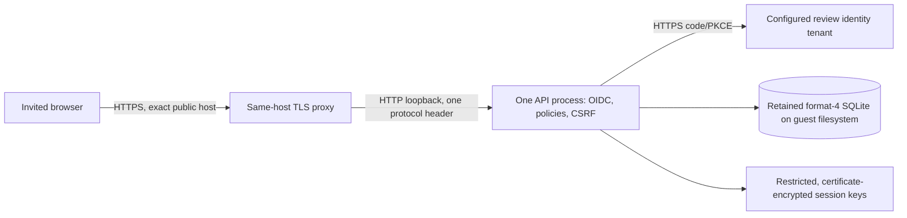

# Prepare the first invited review deployment

**Status: application identity/proxy support implemented and private local Entra role/revocation checks passed; hosting not provisioned or accepted.** This task follows the [Phase 8 requirements](../requirements/phase-8-secure-hosting.md), [ADR 0009](../adr/0009-authenticate-the-shared-case-workspace.md) and [ADR 0010](../adr/0010-trust-a-single-loopback-https-proxy.md). It is a deployment preparation record, not a claim of a running review site.

## Assessment and conditional VM target

[ADR 0012](../adr/0012-gate-cloud-hosting-on-zero-recurring-cost.md) now requires a zero-recurring-cost route and keeps the workspace local while free-tier compatibility is assessed. The [dated cost assessment](zero-cost-review-hosting.md) evaluates App Service F1 with Azure SQL free limits; it does not select or provision that stack. The VM assessment below remains valid as a technical alternative if full-environment costs are separately authorized.

For the first five-user synthetic review environment, the earlier recommendation was **one Linux VM with a single-attached managed data disk, an ordinary guest filesystem and one API process**, plus a same-host TLS proxy. This preserves the implemented local-file transaction/locking and explicit offline lifecycle model without adding a server-database conversion solely to demonstrate hosting. Azure managed disks present block storage to VMs; the actual disk/filesystem/restart/backup configuration still needs validation. [Microsoft managed-disk documentation](https://learn.microsoft.com/en-us/azure/virtual-machines/managed-disks-overview).

| Candidate | Fit for the current implementation | Consequence |
| --- | --- | --- |
| One Linux VM + retained block disk + SQLite | Can retain one ordinary guest filesystem and one process using the existing format-4 store. Same-host proxy fits ADR 0010. | Technical fit, conditional on separate cost authorization. Operator owns OS/runtime/proxy patching, TLS renewal, access/network fences, single-writer deployment, diagnostics and recovery. |
| App Service + current SQLite | Persistent app content is shared storage; temporary/container-local files do not establish retained-store support. | Do not deploy the current SQLite file there on an assumed persistent `/home` or mounted share. This project has not validated such a topology. |
| Container Apps + current SQLite | Container/replica storage is ephemeral; persistent mounted Azure Files is a file share. | Not selected for this retained local-file contract. A single replica alone does not change the storage semantics. |
| Managed application host + Azure SQL | Plausible later direction for reducing VM operations and supporting server-managed persistence. | F1 plus the renewable SQL free tier is now the cost-assessment candidate. Requires a separate platform/provider ADR, real-provider EF Code First model/migrations/adoption and transaction/recovery evidence, plus compatible ingress and session-key storage. It is not a drop-in replacement established by existing SQLite tests. |

The storage findings come from [App Service container persistence](https://learn.microsoft.com/en-us/azure/app-service/configure-custom-container#use-persistent-shared-storage) and [Container Apps storage types](https://learn.microsoft.com/en-us/azure/container-apps/storage-mounts). The fit/selection conclusions above are this project's assessment against its current contract. No region, SKU or production availability guarantee follows from this technical recommendation. The zero-cost constraint in ADR 0012 prevents treating it as approval to deploy paid resources. EF Core Code First remains required when a selected capability needs persistence changes; no persistence change is needed for this ingress slice.

The diagram below describes the conditional VM alternative. A managed-host candidate needs its own ingress/session-key and server-database design; it does not inherit this topology.

## Inputs needed before provisioning

Record deployment-specific values privately; keep real identity identifiers, secrets and reviewer details out of the repository. The [Entra onboarding/smoke plan](../usage/entra-review-verification.md) records the completed private local checks and the remaining hosted identity evidence. [ADR 0011](../adr/0011-use-entra-for-private-review-identity.md) selects Entra; no actual identifiers or credentials belong in these inputs.

| Input | Required decision/evidence |
| --- | --- |
| Identity | Authorized tenant and dedicated local registration verified with one approved account. Still needed: isolated hosted configuration/callback, intended reviewer grants and the remaining independent-user/provider checks. |
| Subscription and owner | Intended subscription, least-privilege runtime/deployment/operator principals and who maintains/releases/retires the environment. |
| Cost and region | Current constraint: $0 out-of-pocket recurring cost. Verify the complete free configuration and service-enforced exhaustion behavior; region remains unselected. Budget alerts are not caps, and temporary credit is not the operating model. Any billed alternative needs explicit cost authorization; no resources are created by this task. |
| Public entry point | Controlled hostname/DNS, certificate issuance/renewal owner and tested same-host proxy configuration. Only the intended public entry point is exposed; restrict operator access separately. |
| Retained state | Establish the selected provider's durability/lifecycle contract. For the VM alternative: dedicated single-attached data disk/filesystem mount outside release output/temporary storage, correct ownership/journal permissions and one process; refuse a missing mount without initializing a replacement. The managed SQL candidate needs its own provider/adoption/recovery evidence. |
| Keys and credentials | Durable protected session-key directory, separate restricted protection certificate/private key and OIDC credential delivery/rotation. Do not embed any of these in an image/release or treat case-creation keys as session keys. |

## Remaining delivery work

1. Complete the [remaining private identity checks](../usage/entra-review-verification.md#local-verification-on-2026-10-26): a separate regular unassigned account, real-provider absolute expiry/failure cases and the actual hosted registration/callback. Local Reader/Caseworker/unmapped-role changes and emergency revision-based revocation already passed. Repeat relevant checks for the intended hosted users and retain only non-sensitive outcome summaries publicly.
2. Complete the [zero-cost compatibility gates](zero-cost-review-hosting.md#ordered-delivery-gates) before selecting a platform/provider. The [managed-host assessment/catalog tool](app-service-compatibility.md) identifies the remaining ingress, persistence and hosted key-delivery gaps. [ADR 0013](../adr/0013-load-protection-certificates-from-private-configuration.md) delivers the configuration-backed certificate source locally; the [managed-ingress/retention contract and undeployed envelope](managed-ingress-verification.md) now define the remaining evidence. The [independent operator probe](../usage/operator-review-probe.md) is now locally tested. Next privately establish the concrete free-tier deployment path and eligibility before any cloud creation review; actual managed-host ingress/key retention remain pending. Keep the VM/disk alternative conditional on separate funding. Prepare reproducible infrastructure/service configuration only for the chosen, cost-compatible region/topology, with no destructive volume formatting, automatic initialization or overlapping writers. Test syntax and the real TLS/network path before use. The current application tests use a proxy fixture, not a deployed Nginx server.
3. Implement/test finite request admission, body/time limits, readiness and minimal restricted diagnostics for the selected topology. `/health` remains storage-independent liveness. Enforce privacy-safe ingress/framework logging and the proposed seven-day restricted-log retention.
4. Rehearse release/restart/offline-upgrade with state and session keys retained. Stop the old process before starting the new writer; inspect uncertain outcomes before any upgrade/retry. Keep release binaries read-only and outside the retained data/key paths. No scale-out, slot overlap or public repair endpoint.
5. Implement backup/restore tooling and an isolated restore exercise against a separate destination, meeting or explicitly revising the proposed 24-hour RPO/four-hour RTO. Preserve the original source, validate retained histories/keys, and demonstrate that snapshot rollback loses later creations/bindings. Disk replication or an untested snapshot is not a complete recovery procedure.
6. Run the five-client synthetic workload, real-provider/browser/proxy/restart/recovery tests and remaining SH acceptance before invitations. Retain reproducible evidence without publishing credentials, tokens, case payloads or real identities.

Local provider verification is complete for the documented checks; the zero-cost constraint is recorded, while platform/region/operating decisions and the remaining identity evidence are still needed. Authentication results do not substitute for hosted operational acceptance. A switch to a managed app host/server database remains a valid later decision when its operating benefits justify the provider/adoption work.
